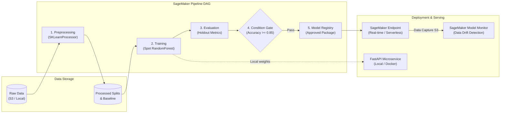

# 📱 AWS SageMaker End-to-End MLOps Pipeline: Mobile Price Classification

[](https://python.org)
[](https://aws.amazon.com/sagemaker/)
[](https://scikit-learn.org/)
[](https://fastapi.tiangolo.com)
[](https://pytest.org)
[](.github/workflows/sagemaker_ci.yaml)

An enterprise-grade, production-ready MLOps project demonstrating the full Machine Learning lifecycle on **Amazon Web Services (AWS) SageMaker**. Built following cloud architectural best practices, this repository showcases automated data preprocessing, managed Spot training, model evaluation gating, Model Registry governance, real-time/serverless endpoint hosting with S3 data capture, and offline local simulation.

---

## 🌟 Key Highlights & Engineering Features

- **Automated SageMaker Pipeline (DAG)**: Fully orchestrated workflow using SageMaker Python SDK (`ProcessingStep` $\to$ `TrainingStep` $\to$ `ProcessingStep` $\to$ `ConditionStep` $\to$ `ModelStep`).
- **Cost Optimization (~70% Savings)**: Configured with **AWS Managed Spot Training** and automatic timeout guards.
- **Automated Quality Gating**: `ConditionStep` evaluates holdout test accuracy ($\ge 85\%$) before promoting models to the **SageMaker Model Registry**.
- **Official SageMaker Inference Contract**: Production serving handler implementing `model_fn`, `input_fn`, `predict_fn`, and `output_fn` with multi-format support (JSON & CSV) and class confidence probabilities.
- **Model Monitoring & Drift Detection**: Configured with `DataCaptureConfig` to log 100% of live inference payloads to S3 for baseline drift analysis.
- **Hybrid Local / Cloud Workflow**: Run the entire pipeline offline via `--local-simulation` or serve models locally with **FastAPI** (`http://localhost:8000/docs`).
- **Production Testing Suite**: 18 automated unit and integration tests passing in under 2 seconds.

---

## 📐 System Architecture



---

## 📁 Repository Structure

```
38_AWS_Sagemaker/
├── .github/
│   └── workflows/
│       └── sagemaker_ci.yaml          # Continuous Integration workflow (Pytest + DAG build)
├── configs/
│   ├── config.yaml                    # AWS, instance types, and pipeline parameters
│   └── model_config.yaml              # Hyperparameters, feature schema, and quality gate thresholds
├── data/
│   ├── raw/
│   │   └── mob_price_classification_train.csv
│   ├── processed/                     # Generated train, validation, and test splits
│   └── baseline/                      # Headerless data baseline for Model Monitor drift tracking
├── docker/
│   ├── Dockerfile.local               # Container for local FastAPI serving
│   └── Dockerfile.sagemaker           # Custom SageMaker container template
├── docs/
│   ├── ARCHITECTURE.md                # System design, data flow, and container contracts
│   ├── SAGEMAKER_DEEP_DIVE.md         # Educational teaching guide (Estimators, Hooks, Cost, etc.)
│   └── INTERVIEW_PREPARATION.md       # 25+ interview questions, STAR pitch, and design answers
├── notebooks/
│   ├── 01_eda_and_baseline.ipynb      # Clean Exploratory Data Analysis & baseline Scikit-Learn model
│   └── 02_sagemaker_pipeline_walkthrough.ipynb # Interactive SageMaker Pipelines walkthrough
├── src/
│   ├── __init__.py
│   ├── config.py                      # Pydantic configuration loader with environment overrides
│   ├── processing/
│   │   ├── __init__.py
│   │   └── preprocess.py              # SageMaker Processing Step: schema validation & stratified split
│   ├── training/
│   │   ├── __init__.py
│   │   └── train.py                   # SageMaker Training Step: Spot training & CloudWatch metrics
│   ├── evaluation/
│   │   ├── __init__.py
│   │   └── evaluate.py                # SageMaker Evaluation Step: outputs standard evaluation.json
│   ├── inference/
│   │   ├── __init__.py
│   │   └── inference.py               # Serving hooks: model_fn, input_fn, predict_fn, output_fn
│   ├── pipeline/
│   │   ├── __init__.py
│   │   ├── sagemaker_pipeline.py      # Declarative SageMaker Pipeline DAG definition
│   │   └── run_pipeline.py            # CLI for building, upserting, and simulating pipeline
│   ├── deployment/
│   │   ├── __init__.py
│   │   ├── deploy_endpoint.py         # Endpoint deployment with DataCaptureConfig
│   │   ├── test_endpoint.py           # Live endpoint test & latency benchmark tool
│   │   └── cleanup.py                 # Resource cleanup script to prevent runaway cloud bills
│   └── api/
│       ├── __init__.py
│       ├── main.py                    # FastAPI application (:8000/docs)
│       └── schemas.py                 # Pydantic schemas for payload validation
├── tests/
│   ├── conftest.py                    # Pytest fixtures (sample payloads, mock model, test client)
│   ├── test_preprocessing.py          # Preprocessing & schema validation tests
│   ├── test_training.py               # Model training & fitting tests
│   ├── test_evaluation.py             # Evaluation report schema tests
│   ├── test_inference.py              # SageMaker inference protocol tests
│   └── test_local_api.py              # FastAPI REST endpoint integration tests
├── .env.example                       # Environment variables template
├── .gitignore
├── Makefile                           # Developer shortcuts (make test, make local-sim, etc.)
├── pyproject.toml                     # Modern package and pytest configuration
├── requirements.txt                   # Local development dependencies
├── requirements-sagemaker.txt         # Lightweight container dependencies
└── README.md                          # Executive documentation
```

---

## ⚡ Quickstart Guide

### 1. Setup Environment
```bash
# Clone and navigate to project
cd 38_AWS_Sagemaker

# Create and activate Python virtual environment
python3 -m venv .venv
source .venv/bin/activate

# Install dependencies and editable package
pip install -r requirements.txt
pip install -e .
```

### 2. Run Automated Test Suite
```bash
pytest -v
```
*Expected: 18 passed in < 2 seconds.*

### 3. Run End-to-End Local Simulation
Executes preprocessing, training, and holdout evaluation locally in seconds:
```bash
python src/pipeline/run_pipeline.py --local-simulation
# or
make local-sim
```

### 4. Compile SageMaker Pipeline DAG to JSON (Offline)
Compiles the complete pipeline DAG and exports the JSON AST definition to `artifacts/pipeline_definition.json` without requiring AWS credentials:
```bash
python src/pipeline/run_pipeline.py --build-only
# or
make compile-pipeline
```

### 5. Launch Local REST API Microservice
```bash
python src/api/main.py
# or
make api
```
- Interactive Swagger UI: **http://localhost:8000/docs**
- Health check: `curl http://localhost:8000/health`
- Predict sample:
```bash
curl -X POST http://localhost:8000/predict \
  -H "Content-Type: application/json" \
  -d '{
    "instances": [{
      "battery_power": 1821, "blue": 1, "clock_speed": 1.2, "dual_sim": 0,
      "fc": 13, "four_g": 1, "int_memory": 44, "m_dep": 0.8, "mobile_wt": 141,
      "n_cores": 6, "pc": 14, "px_height": 1208, "px_width": 1212, "ram": 3911,
      "sc_h": 8, "sc_w": 6, "talk_time": 15, "three_g": 1, "touch_screen": 1, "wifi": 0
    }]
  }'
```

---

## ☁️ Running on AWS SageMaker

### Prerequisites
1. AWS CLI configured (`aws configure`).
2. SageMaker Execution Role with `AmazonSageMakerFullAccess` and S3 bucket access.
3. Configure environment variables in `.env`:
   ```bash
   cp .env.example .env
   # Set SAGEMAKER_ROLE_ARN and S3_BUCKET_NAME
   ```

### Deploy Pipeline & Endpoints on AWS
```bash
# 1. Upsert and execute the pipeline on AWS SageMaker
python src/pipeline/run_pipeline.py --upsert --execute

# 2. Deploy approved model to a live endpoint with Data Capture enabled
python src/deployment/deploy_endpoint.py --model-s3-uri s3://your-bucket/path/model.tar.gz

# 3. Test and benchmark live endpoint latency
python src/deployment/test_endpoint.py --endpoint-name your-endpoint-name

# 4. Clean up resources to prevent unexpected cloud charges
python src/deployment/cleanup.py --endpoint-name your-endpoint-name
```

---

## 📊 Model Evaluation Results

| Metric | Training Split | Validation Split | Holdout Test Split |
| :--- | :--- | :--- | :--- |
| **Accuracy** | 100.0% | 87.00% | **89.67%** |
| **Macro F1-Score** | 1.0000 | 0.8695 | **0.8971** |
| **Weighted F1-Score** | 1.0000 | 0.8695 | **0.8971** |
| **Macro Precision** | 1.0000 | 0.8692 | **0.8982** |
| **Macro Recall** | 1.0000 | 0.8700 | **0.8967** |
| **Sample Count** | 1,400 rows | 300 rows | 300 rows |

*Quality Gate Condition ($\text{Accuracy} \ge 0.85$): **PASSED** $\to$ Promoted to Model Registry.*

---

## 📚 In-Depth Documentation & Study Guides

- **[Architecture Deep Dive](docs/ARCHITECTURE.md)**: Container filesystem contract, sequence diagrams, and IAM security.
- **[SageMaker Technical Guide](docs/SAGEMAKER_DEEP_DIVE.md)**: Teaching guide on Estimators, Processors, Serving Hooks, and Cost Optimization.
- **[Interview Preparation Guide](docs/INTERVIEW_PREPARATION.md)**: 25+ real-world senior interview questions, STAR stories, and system design answers.
