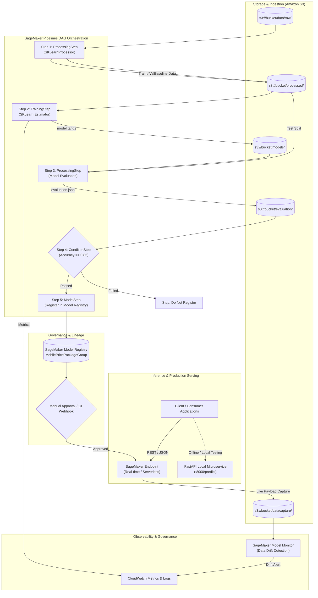

# End-to-End AWS SageMaker MLOps Architecture

This document details the enterprise architecture, container lifecycle, network topologies, and security posture implemented in this project.

---

## 1. High-Level Architecture Overview



---

## 2. Pipeline Execution Stages

### Step 1: Processing Step (`PreprocessMobileData`)
- **Container**: AWS Prebuilt Scikit-Learn Processor (`image_uris.retrieve('sklearn')`).
- **Input**: Raw mobile dataset from S3 or local storage.
- **Actions**:
  - Schema validation (verifies all 20 features and target `price_range`).
  - Missing value imputation using median strategy.
  - Stratified 3-way split: **Train (70%)**, **Validation (15%)**, **Test (15%)**.
  - Baseline dataset generation (headerless 20 features) for SageMaker Model Monitor.
- **Output**: S3 channels mounted to subsequent pipeline stages.

### Step 2: Training Step (`TrainRandomForestModel`)
- **Container**: `sagemaker.sklearn.estimator.SKLearn`.
- **Infrastructure**: Managed Spot Instances (`use_spot_instances=True`) to reduce training compute costs by up to 70%.
- **Metrics Emission**: Custom regex filters parse training and validation metrics (`accuracy`, `f1`, `precision`, `recall`) directly into Amazon CloudWatch Metrics.
- **Artifact**: `model.joblib` and `metadata.json` packaged into `model.tar.gz`.

### Step 3: Evaluation Step (`EvaluateModelQuality`)
- **Input**: Model artifacts from Step 2 and holdout Test dataset from Step 1.
- **Actions**: Unpacks `model.tar.gz`, performs inference across the unseen test split, and computes multi-class classification metrics (accuracy, macro/weighted F1, precision, recall, and full confusion matrix).
- **Output**: Generates `evaluation.json` strictly formatted to SageMaker Model Quality Specification.

### Step 4: Quality Gate Decision (`CheckEvaluationAccuracyGate`)
- **Type**: `sagemaker.workflow.condition_step.ConditionStep`.
- **Condition**: Holdout test accuracy must satisfy:
  $$\text{Accuracy} \ge 0.85$$
- **Behavior**:
  - If **True**: Proceeds to Step 5 (Register Model).
  - If **False**: Halts pipeline execution without registering the model, preventing degraded models from reaching staging or production.

### Step 5: Model Registry Registration (`RegisterApprovedModelPackage`)
- **Catalog**: Registers the model version into `MobilePriceClassificationModelPackageGroup`.
- **Metadata**: Associates evaluation metrics (`ModelMetrics`), container inference code (`src/inference/inference.py`), and sets approval status to `PendingManualApproval`.

---

## 3. SageMaker Container Filesystem Contract

AWS SageMaker manages container execution through strict POSIX directory conventions:

```
/opt/ml/
├── input/
│   ├── config/
│   │   ├── hyperparameters.json      # Hyperparameters passed to Estimator
│   │   ├── inputdataconfig.json      # Channel configuration
│   │   └── resourceconfig.json       # Hostnames and cluster topology
│   └── data/
│       ├── train/                    # Channel SM_CHANNEL_TRAIN
│       └── validation/               # Channel SM_CHANNEL_VALIDATION
├── processing/
│   ├── input/                        # Processing input mounts
│   ├── train/                        # Processing output
│   ├── validation/                   # Processing output
│   ├── test/                         # Processing output
│   └── evaluation/                   # Output for evaluation.json
├── model/                            # SM_MODEL_DIR: Compressed into model.tar.gz
└── output/
    └── data/                         # SM_OUTPUT_DATA_DIR: Failure logs and reports
```

---

## 4. Security & Governance

1. **IAM Least Privilege**:
   - Training & Processing roles only access the designated S3 bucket prefix and Amazon CloudWatch Logs.
2. **Encryption**:
   - Data at rest in S3 encrypted with AWS KMS (`aws:kms`).
   - Inter-container training communication encrypted via TLS when distributed.
3. **VPC Integration**:
   - Subnets and security groups can be attached to Estimators and Processors to keep network traffic inside private corporate subnets without public internet exposure.
