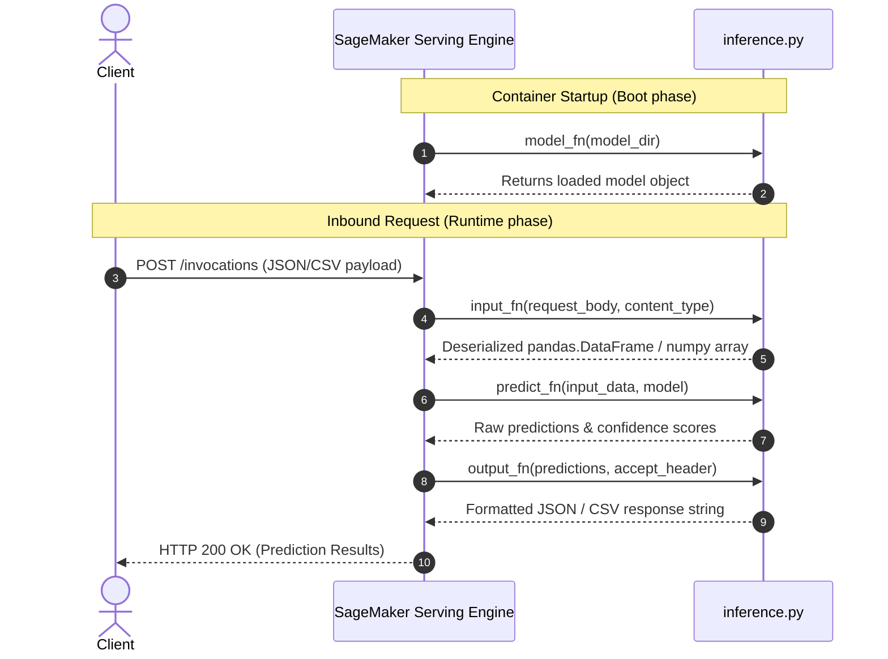

# AWS SageMaker: The Complete Engineering & Architectural Deep Dive

This comprehensive guide is designed to take you from foundational concepts to advanced production patterns in Amazon SageMaker. Use this as your reference guide and study companion.

---

## 1. What is Amazon SageMaker?

At its core, **Amazon SageMaker** is a fully managed Machine Learning platform that abstracts infrastructure management across the ML lifecycle:
- **Data Preparation**: Managed processing clusters (`ProcessingStep` / `Data Wrangler`).
- **Distributed Training**: Ephemeral compute instances provisioned on-demand, billed by the second, and terminated automatically upon completion (`TrainingStep`).
- **Pipeline Orchestration**: Declarative DAG orchestration natively integrated with AWS IAM, CloudWatch, and EventBridge (`SageMaker Pipelines`).
- **Model Governance**: Centralized catalog for versioning, approving, and tracking lineage (`Model Registry`).
- **Hosting & Serving**: Managed endpoints with automatic multi-AZ failover, auto-scaling, and rolling blue/green deployments.

### Why Enterprise Teams Use SageMaker vs Bare EC2 / Kubernetes:
| Feature | Bare EC2 | Self-Hosted Kubernetes (EKS) | AWS SageMaker |
| :--- | :--- | :--- | :--- |
| **Cluster Provisioning** | Manual setup / AMI baking | High operational overhead | 100% managed & ephemeral |
| **Spot Training Interruption** | Manual checkpoint scripts | Requires custom operators | Managed Spot Training built-in |
| **Model Registry & Lineage** | Requires MLflow/custom DB | Third-party tooling required | Built-in Model Registry |
| **Zero-Downtime Deployment** | Complex Nginx/ALB setup | Ingress controller / Istio | Native Blue/Green & Canary |
| **Model Monitoring** | Custom daemon logging | Custom Prometheus/Grafana | Native Data Capture & Monitor |

---

## 2. Core Building Blocks & Abstractions

### A. Estimators
An **Estimator** is a high-level Python abstraction that encapsulates:
1. The **Docker Container** (prebuilt AWS image or custom ECR image).
2. The **Compute Hardware** (`instance_type="ml.m5.large"`, `instance_count=1`).
3. The **Training Script** (`entry_point="train.py"`).
4. The **Hyperparameters** (passed to the entrypoint as CLI flags).

```python
from sagemaker.sklearn.estimator import SKLearn

sklearn_estimator = SKLearn(
    entry_point="train.py",
    source_dir="src/training",
    role="arn:aws:iam::...",
    instance_type="ml.m5.large",
    instance_count=1,
    framework_version="1.2-1",
    use_spot_instances=True,
    max_run=3600,
    max_wait=7200,
    hyperparameters={"n_estimators": 150, "max_depth": 15}
)
```

### B. Processors
A **Processor** executes arbitrary data processing, feature engineering, or model evaluation tasks on isolated ephemeral instances.
- **`SKLearnProcessor`**: Pre-configured with Scikit-learn, Pandas, and NumPy.
- **`ScriptProcessor`**: Custom base Docker images.
- **`PySparkProcessor`**: Serverless distributed Spark clusters.

### C. SageMaker Pipelines (DAG Engine)
SageMaker Pipelines defines reproducible Directed Acyclic Graphs (DAGs) using typed steps:
1. `ProcessingStep`: Runs a processor.
2. `TrainingStep`: Runs an estimator.
3. `ConditionStep`: Conditional branching logic (e.g., Accuracy >= 0.85).
4. `ModelStep`: Registers or creates model packages.
5. `FailStep`: Explicitly terminates execution with error messages.

---

## 3. The SageMaker Container Contract

When SageMaker spins up a container for training or processing, it interacts with the container strictly via filesystem paths and environment variables.

### Key Environment Variables in SageMaker Containers:
- `SM_MODEL_DIR` (`/opt/ml/model`): Anything written here is compressed into `model.tar.gz` and uploaded to S3 upon container exit.
- `SM_CHANNEL_TRAIN` (`/opt/ml/input/data/train`): Local directory where training data from S3 is mounted.
- `SM_CHANNEL_VALIDATION` (`/opt/ml/input/data/validation`): Validation data channel.
- `SM_HPS`: JSON string containing hyperparameters.
- `SM_CURRENT_HOST`: Hostname of the current container in distributed training.
- `SM_HOSTS`: JSON array of all hostnames in the cluster.

---

## 4. The SageMaker Inference Protocol (The 4 Hooks)

When deploying a model using the Scikit-learn or PyTorch container, SageMaker serves traffic using a multi-worker web server (TorchServe or Gunicorn). Your serving script (`inference.py`) must implement 4 handler functions:



### Code Implementation:
1. **`model_fn(model_dir)`**: Loads model from disk.
   ```python
   def model_fn(model_dir):
       clf = joblib.load(os.path.join(model_dir, "model.joblib"))
       return clf  # CRITICAL: Always return the model!
   ```
2. **`input_fn(request_body, request_content_type)`**: Validates and parses incoming payload into a DataFrame.
3. **`predict_fn(input_data, model)`**: Runs `model.predict()` and `model.predict_proba()`.
4. **`output_fn(prediction, accept)`**: Formats output as JSON or CSV according to the client's `Accept` header.

---

## 5. SageMaker Inference Endpoints: Comparison & Selection

| Deployment Type | Use Case | Latency | Billing Model | Max Payload |
| :--- | :--- | :--- | :--- | :--- |
| **Real-time Endpoint** | Mission-critical apps, sub-second SLAs | 10-50 ms | Per instance-hour (24/7) | 6 MB |
| **Serverless Inference** | Intermittent traffic, dev/test, cost-saving | 100 ms - 2s (cold start) | Per compute duration (ms) | 4 MB |
| **Asynchronous Inference** | Large payloads (CV, NLP), processing > 1 min | Minutes | Per instance-hour (can scale to 0) | 1 GB (via S3) |
| **Batch Transform** | Offline batch scoring over large datasets | Minutes/Hours | Ephemeral instance-hours | Unlimited |

---

## 6. Enterprise Cost Optimization Playbook

1. **Managed Spot Training**:
   - Set `use_spot_instances=True` on your Estimator.
   - Saves **60% to 90%** on EC2 compute costs.
   - Always set `max_wait >= max_run` (e.g., `max_run=3600`, `max_wait=7200`) so SageMaker can wait for available spot capacity if reclaimed.
2. **Serverless Inference for Dev/Staging**:
   - Instead of paying \$70+/month for an idle `ml.m5.large` endpoint in staging, configure `ServerlessInferenceConfig(memory_size_in_mb=2048, max_concurrency=5)` to pay \$0 when no requests arrive.
3. **S3 Lifecycle Rules**:
   - Automatically transition old training outputs and raw processing files to Amazon S3 Glacier or expire after 90 days.
4. **Auto-Scaling on Real-Time Endpoints**:
   - Configure AWS Application Auto Scaling with target tracking based on `SageMakerVariantInvocationsPerInstance` to scale from 1 instance up to $N$ during peak traffic.

---

## 7. Model Monitoring & Data Drift

In production, models degrade as real-world data shifts away from training distributions.
1. **Data Capture (`DataCaptureConfig`)**:
   - Ingests a configurable percentage (e.g., 100%) of live inference requests and responses directly into an S3 prefix without adding latency to the client response.
2. **Baseline Generation (`baseline.csv`)**:
   - Created during the preprocessing step from the training dataset.
   - SageMaker Model Monitor analyzes this baseline to generate baseline statistics and constraints (`statistics.json`, `constraints.json`).
3. **Scheduled Monitoring Jobs**:
   - An hourly or daily cron job compares incoming captured production data against the baseline constraints.
   - If drift exceeds statistical thresholds (e.g. KS-test or Jensen-Shannon divergence), it triggers an Amazon CloudWatch Alarm, alerting the MLOps team or kicking off an automated pipeline execution.
