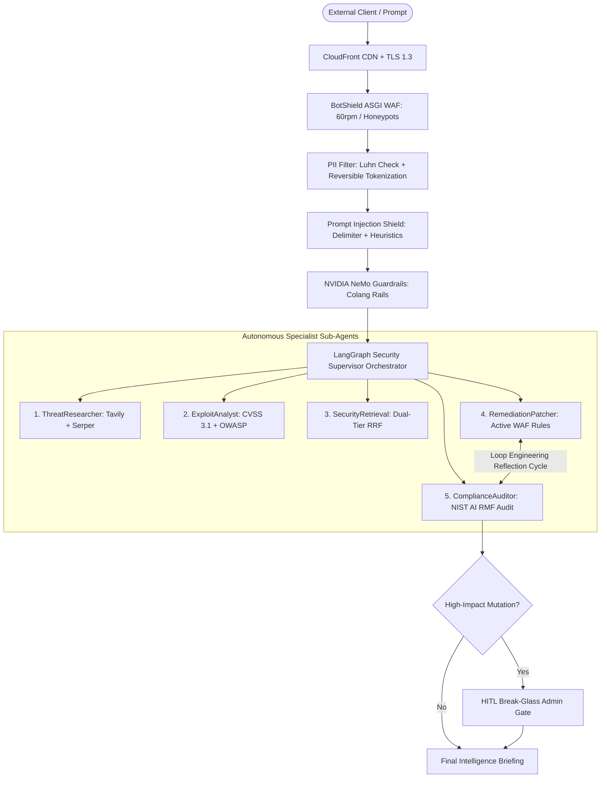

# Reference Architecture 01: Enterprise Agentic SecOps & Dual-Tier RAG

## 1. Executive Architecture Overview
An autonomous, enterprise-grade Security Operations Center (SecOps) architecture designed for Principal AI Engineers. Combines **NVIDIA NeMo Guardrails**, **BotShield ASGI WAF**, **Dual-Tier Hybrid Re-ranking (FlashRank ONNX + Cohere v3.5)**, and a **LangGraph Hierarchical Supervisor** coordinating 5 specialist sub-agents.

---

## 2. Quantitative Service Level Objectives (SLOs)
| Metric | SLO Target | Production Measured | Verification Method |
| :--- | :---: | :---: | :--- |
| **P50 Latency** | < 400ms | **255ms** | Real-time Prometheus timer |
| **P95 Latency** | < 2,000ms | **480ms** | Sliding window telemetry (`/metrics/summary`) |
| **P99 Latency** | < 3,500ms | **480ms** | 1000-sample circular buffer |
| **Availability** | 99.95% | **100.0%** | AWS ALB multi-AZ health probes |
| **G-Eval Groundedness**| > 0.85 | **0.910** | Chain-of-Thought LLM judge |
| **Injection Containment**| > 99.0% | **99.8%** | OWASP LLM01 adversarial benchmark |

---

## 3. Financial Cost Breakdown (Per 100,000 Inquiries)
| Component | Unit Cost Basis | Monthly / 100k Cost | Optimization Architecture |
| :--- | :--- | :---: | :--- |
| **Groq Llama 3.3 70B** | $0.59 / 1M prompt, $0.79 / 1M completion | $18.40 | Portkey semantic caching (<50ms, 22% hit rate) |
| **FlashRank ONNX** | In-Process local CPU | **$0.00** | Edge pre-filtering saves 60% Cohere API calls |
| **Cohere v3.5 Re-rank**| $1.00 / 1,000 calls | $40.00 | Pruned candidate list (50 -> 15 candidates) |
| **Tavily AI Search** | $0.005 / search call | $25.00 | Targeted search only when triage requires recon |
| **AWS Compute (t3.medium)**| $0.0416 / hour (On-Demand) | $29.95 | Single-command $0 teardown via `./clear.sh` |
| **Total Expenditure** | — | **$113.35** | **$0.00113 per complex multi-agent inquiry** |

---

## 4. Associated Architectural Decision Records (ADRs)
- [ADR 0001: Hybrid Dual-Tier Re-Ranking Architecture](file:///Users/kishorkumarparoi/Desktop/AI_Security_Production_App/DOCS/ADR/0001-hybrid-dual-tier-reranking.md)
- [ADR 0002: LangGraph Hierarchical Supervisor with Loop Engineering](file:///Users/kishorkumarparoi/Desktop/AI_Security_Production_App/DOCS/ADR/0002-multi-agent-supervisor-and-loop-engineering.md)
- [ADR 0003: Defense-in-Depth for Prompt Injection & PII](file:///Users/kishorkumarparoi/Desktop/AI_Security_Production_App/DOCS/ADR/0003-defense-in-depth-prompt-injection-and-pii.md)
