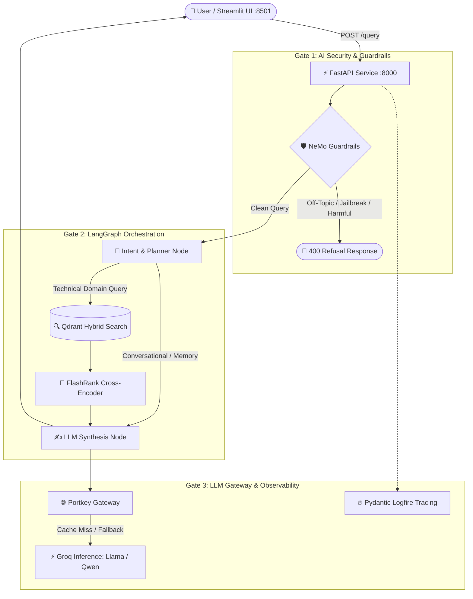

# 🛡️ Enterprise AI Security & Production Agentic RAG

A production-grade Enterprise Agentic RAG microservice equipped with **NVIDIA NeMo Guardrails** (input/output safety, jailbreak defense, topic gating), **LangGraph Cyclic Agent Workflows**, **Portkey LLM Gateway** (cache, retry, fallback routing), **Qdrant Vector Database**, and **Pydantic Logfire** observability.

---

## 🏗️ Architecture Overview



---

## 🚀 Quickstart & Running the Application

Both services run inside the virtual environment (`.venv`).

### 1. Unified Launcher
Run both FastAPI Backend and Streamlit UI together:
```bash
python main.py
```

Or run services individually:
```bash
# FastAPI Backend only (port 8000)
python main.py --api

# Streamlit UI only (port 8501)
python main.py --ui
```

### 2. Standard Commands
```bash
# Backend (FastAPI with Auto-Reload)
./.venv/bin/python -m uvicorn app.main:app --host 127.0.0.1 --port 8000 --reload

# Frontend (Streamlit Dashboard)
./.venv/bin/streamlit run ui/app.py --server.port 8501
```

---

## 🌐 Endpoints & Web Interfaces

| Service | Address | Description |
| :--- | :--- | :--- |
| **Streamlit UI** | [http://localhost:8501](http://localhost:8501) | Full interactive chat dashboard with thought tracing & memory reset |
| **FastAPI Docs** | [http://localhost:8000/docs](http://localhost:8000/docs) | Swagger UI for exploring the REST API schema |
| **Health Check** | `GET http://localhost:8000/` | API status and readiness probe |
| **Query Engine** | `POST http://localhost:8000/query` | Guardrails + LangGraph inference pipeline |
| **Workflow Graph** | `GET http://localhost:8000/graph` | Mermaid diagram image of cyclic agent graph |

---

## 🛡️ AI Security & Guardrail Rules

Configured in `app/guardrails/`:
1. **Off-Topic Gating**: Disallows generic casual requests (cooking, jokes, general knowledge) outside Kubernetes, Intel hardware, and enterprise networking.
2. **Jailbreak Defense**: Blocks instructions to ignore constraints, developer mode overrides, and DAN-style persona injections.
3. **Conversational Dialog**: Gracefully resolves greetings, capabilities requests, and farewells without triggering expensive vector search.
