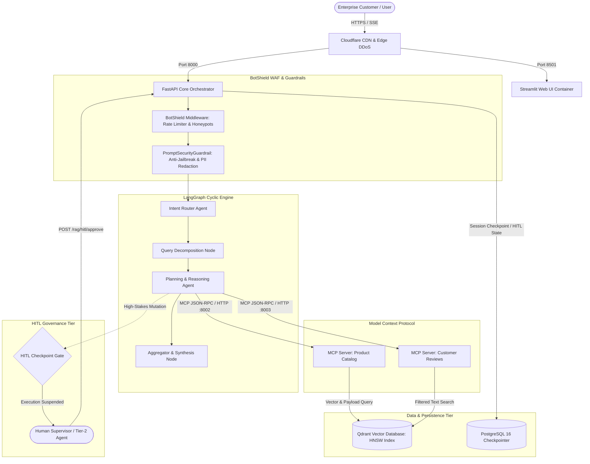
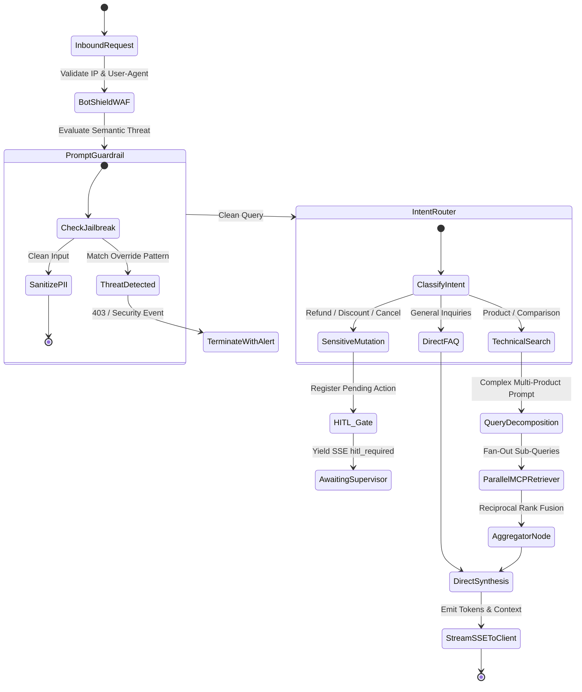
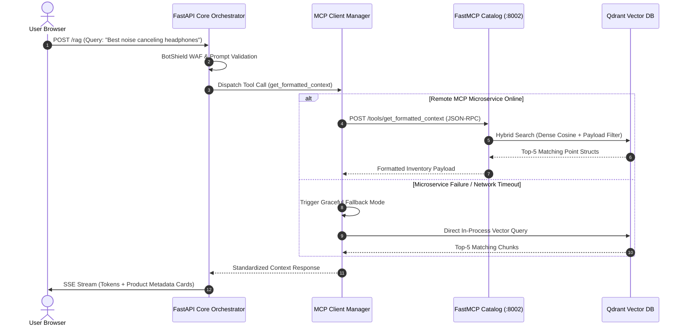
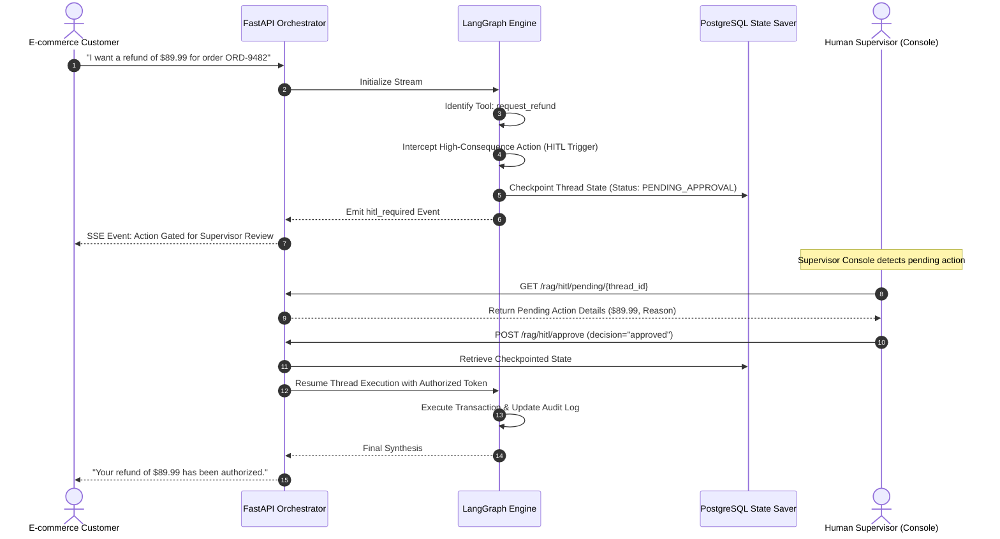

# 🏛️ Enterprise System Architecture & Design Specification

## 1. Architectural Philosophy & C4 Model

The **Enterprise Autonomous AI Production Chatbot Platform** is designed for high-availability, mission-critical e-commerce operations. It rejects monolithic script designs in favor of **Decoupled Microservices**, **Polyglot Model Context Protocol (MCP)** tool execution, **LangGraph Finite State Machines (FSM)**, and **Zero-Trust Edge Security**.

### C4 Container Model



---

## 2. LangGraph Stateful Execution Flow

The core reasoning engine is modeled as a stateful, cyclic directed graph using LangGraph:



---

## 3. Model Context Protocol (MCP) Transport Specification

Tools are not hardcoded inside the orchestrator; they are managed as independent FastMCP microservices adhering to the Anthropic Model Context Protocol standard:



---

## 4. Human-in-the-Loop (HITL) Checkpoint Sequence



---

## 5. Security & Threat Mitigation Architecture

```
Layer 1: Network & Edge Security (BotShield WAF)
├── Honeypot Endpoint Traps (/.env, /.git, /wp-admin) -> Immediate 600s Ban
├── Automated Scanner Drops (sqlmap, nikto, wpscan, nmap User-Agents)
└── Sliding-Window Rate Limiter (60 req/min per IP, 8 req/sec burst limit)

Layer 2: Pre-Flight Guardrails (PromptSecurityGuardrail)
├── Adversarial Regex Interception (DAN, Jailbreaks, Instruction Overrides)
├── Delimiter Evasion Defense (### System, [INST], <system> tags)
└── PII & Secrets Redaction (Credit Cards, SSNs, API Key Regex)

Layer 3: Application Runtime Governance (HITL)
├── Sensitive Action Detection (Refunds, Discounts > 15%, Order Cancellations)
├── State Checkpoint Serialization (PostgreSQL 16)
└── Authenticated Dual-Key Supervisor Sign-Off
```

---

## 6. Latency Budget & SLA Profile

| Processing Phase | Target Latency | P95 Latency | Architectural Optimization |
| :--- | :--- | :--- | :--- |
| **BotShield WAF Evaluation** | `< 1 ms` | `2 ms` | In-memory hash set lookup & compiled regexes. |
| **Prompt Guardrail & PII Scan** | `< 3 ms` | `5 ms` | Pre-compiled regex patterns before LLM network calls. |
| **Intent Classification Node** | `180 ms` | `320 ms` | Compact `gpt-4.1-mini` with Pydantic structured output. |
| **Qdrant Vector Retrieval** | `15 ms` | `35 ms` | HNSW indexed search with memory payload caching. |
| **MCP Tool Network Round-Trip** | `25 ms` | `45 ms` | Keep-alive HTTP connection pooling via `httpx`. |
| **First Token Latency (TTFT)** | `420 ms` | `750 ms` | Server-Sent Events (SSE) streaming direct to client. |
| **Total Pipeline Completion** | `1200 ms` | `2400 ms` | Parallel sub-query decomposition and fusion. |
