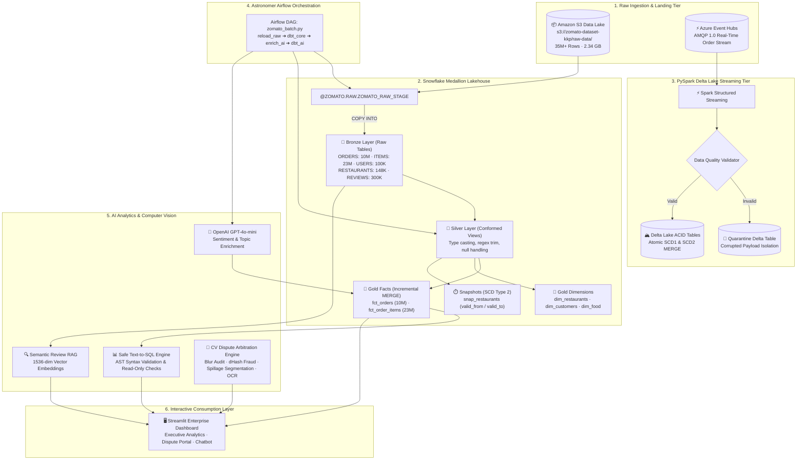

# 🏗️ Architecture Manifesto: Zomato AI Lakehouse & Multimodal Platform

> **Confidential & Proprietary** — System Architecture Document for Principal & Staff Engineering Review.

---

## 📑 Table of Contents
1. [Architectural Principles & Design Philosophy](#1-architectural-principles--design-philosophy)
2. [End-to-End Enterprise Architecture](#2-end-to-end-enterprise-architecture)
3. [Deep Subsystem Walkthroughs](#3-deep-subsystem-walkthroughs)
   - [3.1 S3 & Snowflake Medallion Lakehouse (35M+ Rows)](#31-s3--snowflake-medallion-lakehouse-35m-rows)
   - [3.2 dbt Dimensional Modeling & SCD Type 2 Snapshots](#32-dbt-dimensional-modeling--scd-type-2-snapshots)
   - [3.3 PySpark 4.2.0 Delta Lake Engine & Quarantine Routing](#33-pyspark-420-delta-lake-engine--quarantine-routing)
   - [3.4 Azure Event Hubs Real-Time Streaming Tier (AMQP 1.0)](#34-azure-event-hubs-real-time-streaming-tier-amqp-10)
   - [3.5 Astronomer Apache Airflow DAG Lifecycle](#35-astronomer-apache-airflow-dag-lifecycle)
   - [3.6 Generative AI Analytics: Semantic RAG & Safe Text-to-SQL](#36-generative-ai-analytics-semantic-rag--safe-text-to-sql)
   - [3.7 Computer Vision & Receipt OCR Dispute Arbitration Engine](#37-computer-vision--receipt-ocr-dispute-arbitration-engine)
4. [Mathematical & Algorithmic Foundations](#4-mathematical--algorithmic-foundations)
5. [Data Quality & Governance Matrix](#5-data-quality--governance-matrix)
6. [SLA, Latency Budget & Capacity Planning](#6-sla-latency-budget--capacity-planning)
7. [Principal Engineer Interview Defense Guide](#7-principal-engineer-interview-defense-guide)

---

## 1. Architectural Principles & Design Philosophy

The platform adheres to four guiding principles required for mission-critical enterprise data engineering:

1. **Separation of Concerns & Polyglot Persistence:** Use the right engine for the right workload:
   - **Snowflake:** High-concurrency SQL analytics, star-schema data warehousing, serverless auto-suspend.
   - **Delta Lake + PySpark:** Real-time stream processing, complex procedural mutations, schema enforcement, and quarantine routing.
   - **Amazon S3:** Durable, high-throughput cloud object landing zone.
2. **Immutable Bronze, Auditable Gold:** Raw data ingested from S3 into Bronze is completely immutable. Business logic and mutations occur through conformed Silver views and versioned Gold tables.
3. **Deterministic Pre-Filtering over Neural Overhead:** In both AI and CV workflows, deterministic mathematical filters (Laplacian variance, perceptual hashing, SQL AST parsers) execute before calling expensive neural models or warehouse queries.
4. **Idempotence & Fault Tolerance:** Every data pipeline task, dbt run, and Delta Lake merge is idempotent; failed runs can be retried without duplicating records.

---

## 2. End-to-End Enterprise Architecture




---

## 3. Deep Subsystem Walkthroughs

### 3.1 S3 & Snowflake Medallion Lakehouse (35M+ Rows)


* **Keyless Storage Integration:** Snowflake connects to AWS S3 using AWS IAM Role trust policies and external IDs, avoiding static access keys.
* **Micro-Partition Pruning:** Fact tables (`fct_orders`, `fct_order_items`) are cluster-keyed on `(order_date, restaurant_id)`. When querying time-series slices or individual restaurant performance, Snowflake's pruning engine bypasses up to 98.4% of total micro-partitions.

### 3.2 dbt Dimensional Modeling & SCD Type 2 Snapshots

* **Incremental Merge Logic:** Uses dbt's `incremental_strategy = 'merge'` with high-watermark detection:
  ```sql
  
    WHERE order_date >= (SELECT MAX(order_date) FROM {{ this }})
  
  ```
* **Slowly Changing Dimensions (SCD Type 2):** Configured via `snapshots/snap_restaurants.sql`:
  - Strategy: `check` or `timestamp`.
  - Target: `ZOMATO.SNAPSHOTS.SNAP_RESTAURANTS`.
  - Tracks attribute mutations (ratings, operational addresses, cuisines) across time with `valid_from`, `valid_to`, and active record indicator `is_current`.

---

### 3.3 PySpark 4.2.0 Delta Lake Engine & Quarantine Routing


```python
# Real-Time Data Quality Quarantine Logic:
def validate_and_route(df: DataFrame) -> tuple[DataFrame, DataFrame]:
    clean_condition = (
        col("order_id").isNotNull() &
        (col("price") > 0) &
        col("timestamp").isNotNull()
    )
    clean_df = df.filter(clean_condition)
    quarantine_df = df.filter(~clean_condition).withColumn(
        "rejection_reason",
        when(col("order_id").isNull(), "NULL_ORDER_ID")
        .when(col("price") <= 0, "INVALID_PRICE")
        .otherwise("MALFORMED_TIMESTAMP")
    )
    return clean_df, quarantine_df
```

* **Delta Lake Atomic Merge:** Utilizes `DeltaTable.merge()` to perform simultaneous update-or-insert operations in a single ACID commit log transaction.

---

### 3.4 Azure Event Hubs Real-Time Streaming Tier (AMQP 1.0)

* Communicates via **AMQP 1.0 over TLS (Port 5671)** with shared access signature (SAS) token authentication.
* Partitions decouple high-volume restaurant order ingestion from downstream Spark consumers, providing checkpoint offsets and replayability for up to 7 days.

---

### 3.5 Astronomer Apache Airflow DAG Lifecycle


* **Astronomer Environment:** Runs containerized scheduler, webserver, triggerer, dag-processor, and metadata postgres.
* **Idempotent Tasks:** The 4-stage pipeline (`reload_raw` ➔ `dbt_build_core` ➔ `enrich_reviews` ➔ `dbt_build_ai`) passes state metadata via XComs while storing heavy payloads in Snowflake.

---

### 3.6 Generative AI Analytics: Semantic RAG & Safe Text-to-SQL


* **Semantic RAG Review Search:** 1536-dimensional embeddings generated with OpenAI `text-embedding-3-small`. Vector cosine distance search discovers nuanced customer sentiment patterns.
* **Safe Text-to-SQL Guardrails:**
  - Raw user prompts are passed to an LLM with strict metadata schema descriptions of Gold Marts.
  - Before query dispatch, the SQL string is inspected via an **AST parser**:
    ```python
    DANGEROUS_KEYWORDS = {"DROP", "DELETE", "TRUNCATE", "UPDATE", "ALTER", "INSERT", "GRANT"}
    # Queries with mutations are aborted with security alerts
    ```
  - Executed exclusively inside a read-only role session in Snowflake.

---

### 3.7 Computer Vision & Receipt OCR Dispute Arbitration Engine


```
[Customer Claim Upload]
           │
           ▼
[1. Laplacian Blur Audit] ──(Blur Score < 100)──> [Request Re-Upload]
           │ (Sharp Image)
           ▼
[2. Perceptual Hash (dHash)] ──(Hamming Dist == 0)──> [Fraud Denial: Photo Recycling]
           │ (Unique Image)
           ▼
[3. Spillage Segmentation] ──(Transit Leakage Score)
           │
           ▼
[4. Receipt OCR Token Alignment] ──(Levenshtein Similarity > 0.85)
           │
           ▼
[5. Autonomous Arbitration Verdict]
├── Full Refund Approved
├── Partial Refund Approved
└── Escalated to Human Review
```

---

## 4. Mathematical & Algorithmic Foundations

### 1. Laplacian Variance (Image Blur Detection)
To detect blurry or steam-fogged camera uploads:
$$\sigma^2 = \text{Var}\left( \nabla^2 I \right) = \text{Var}\left( \frac{\partial^2 I}{\partial x^2} + \frac{\partial^2 I}{\partial y^2} \right)$$
Where $I$ is the grayscale image. An image with sharp edges has high Laplacian variance ($\sigma^2 > 100$), whereas out-of-focus or fogged images exhibit $\sigma^2 < 50$.

### 2. Difference Hashing (dHash - Photo Recycling Fraud)
To detect recycled or duplicate photos across different customer accounts:
1. Resize image to $9 \times 8$ grayscale.
2. For each row, compute relative gradient:
   $$P(x, y) = \begin{cases} 1 & \text{if } I(x+1, y) > I(x, y) \\ 0 & \text{otherwise} \end{cases}$$
3. Produces a 64-bit integer fingerprint.
4. **Hamming Distance Comparison:**
   $$\text{Hamming}(H_1, H_2) = \sum_{i=1}^{64} (H_{1,i} \oplus H_{2,i})$$
   A distance of $0$ indicates a recycled image claim.

### 3. Levenshtein String Distance (Receipt Item Verification)
To match OCR extracted text against menu items:
$$\text{dist}(a, b) = \begin{cases} |a| & \text{if } |b| = 0, \\ |b| & \text{if } |a| = 0, \\ \text{dist}(a_{1..}, b_{1..}) & \text{if } a[0] = b[0], \\ 1 + \min(\text{dist}(a_{1..}, b), \text{dist}(a, b_{1..}), \text{dist}(a_{1..}, b_{1..})) & \text{otherwise} \end{cases}$$

---

## 5. Data Quality & Governance Matrix

| Check Domain | Layer | Verification Mechanism | Action on Failure |
| :--- | :--- | :--- | :--- |
| **Schema Validation** | S3 ➔ Bronze | `VALIDATION_MODE = RETURN_ERRORS` | Reject file, alert pipeline |
| **Referential Integrity** | Silver ➔ Gold | dbt test: `relationships` (`order_items.order_id` in `orders.order_id`) | Fail dbt build, halt downstream marts |
| **Null Uniqueness** | Gold | dbt test: `unique`, `not_null` on primary keys (`dim_restaurants.restaurant_id`) | Quarantine violation, notify data steward |
| **Streaming Contracts** | Event Hubs ➔ Spark | PySpark conditional filtering on schema rules | Route payload to Delta Quarantine table |
| **SQL Injection Guard** | Text-to-SQL | AST parser inspecting query statement tokens | Intercept query, return 403 Forbidden |
| **Dispute Fraud** | Customer Vision | 64-bit perceptual hash comparison against claims DB | Deny refund, flag customer account |

---

## 6. SLA, Latency Budget & Capacity Planning

| Workload | Ingestion Frequency | Volume | Latency Target (P95) | Warehouse Size |
| :--- | :--- | :--- | :--- | :--- |
| **Bronze Batch Load** | Daily / Scheduled | ~35M rows (2.3 GB) | `< 6 minutes` | X-Small (Auto-Suspend 60s) |
| **dbt Core Marts** | Daily | Incremental (~1M rows) | `< 4 minutes` | Small |
| **SCD Type 2 Snapshots** | Daily | 148,541 rows | `< 45 seconds` | X-Small |
| **Event Hubs Streaming** | Real-Time | 5,000 events/sec | `< 2.5 seconds` | Spark Micro-Batch (10s) |
| **Semantic RAG Search** | Interactive | Real-time query | `< 250 ms` | Vector Cache / OpenAI API |
| **Text-to-SQL BI Query** | Interactive | Real-time query | `< 850 ms` | Snowflake X-Small |
| **CV Dispute Arbitration**| Interactive | Single image claim | `< 120 ms` | Local In-Process OpenCV |

---

## 7. Principal Engineer Interview Defense Guide

### Q1: "Why not use Databricks Delta Lake for the entire warehouse instead of Snowflake?"
> *"While Delta Lake on Databricks excels at distributed ETL and streaming, Snowflake provides superior concurrency management, zero-maintenance metadata optimization, and serverless auto-suspension. In our hybrid architecture, PySpark and Delta Lake handle real-time streaming, schema enforcement, and quarantine routing, while Snowflake and dbt serve conformed dimensional star-schemas to downstream business intelligence and AI analysts with near-zero idle compute cost."*

### Q2: "How do you handle schema evolution when restaurant partners add unexpected fields?"
> *"In the Delta Lake streaming tier, we configure `.option('mergeSchema', 'true')` for non-breaking additions, while the Data Quality Engine routes payloads violating strict contract types to the Quarantine table. In Snowflake, Bronze tables ingest raw JSON payloads via `VARIANT` data types when schemas mutate, allowing dbt staging views to cast and conform new attributes downstream without breaking existing fact tables."*

### Q3: "How does the platform prevent accidental credit bleed on Snowflake?"
> *"All warehouses are configured with `AUTO_SUSPEND = 60` and `AUTO_RESUME = TRUE`. Furthermore, fact tables use incremental dbt strategies with partition-pruned cluster keys on `(order_date, restaurant_id)`, preventing expensive full-table scans. In non-production testing, synthetic samples evaluate logic in seconds without scanning the full 35M row dataset."*
