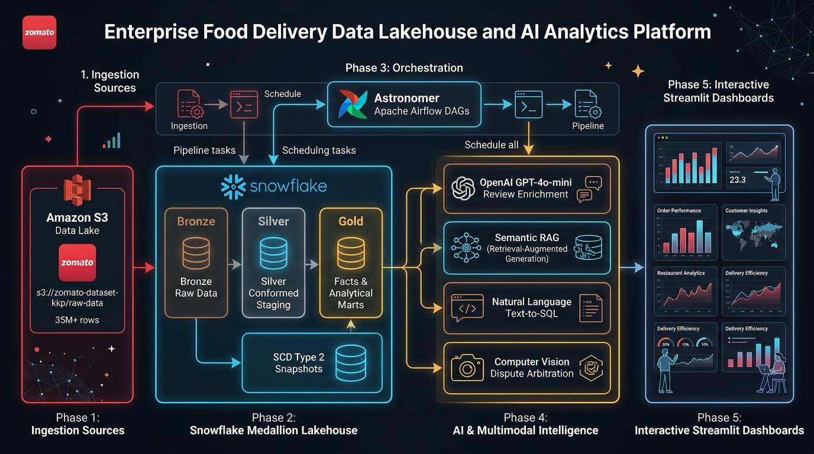
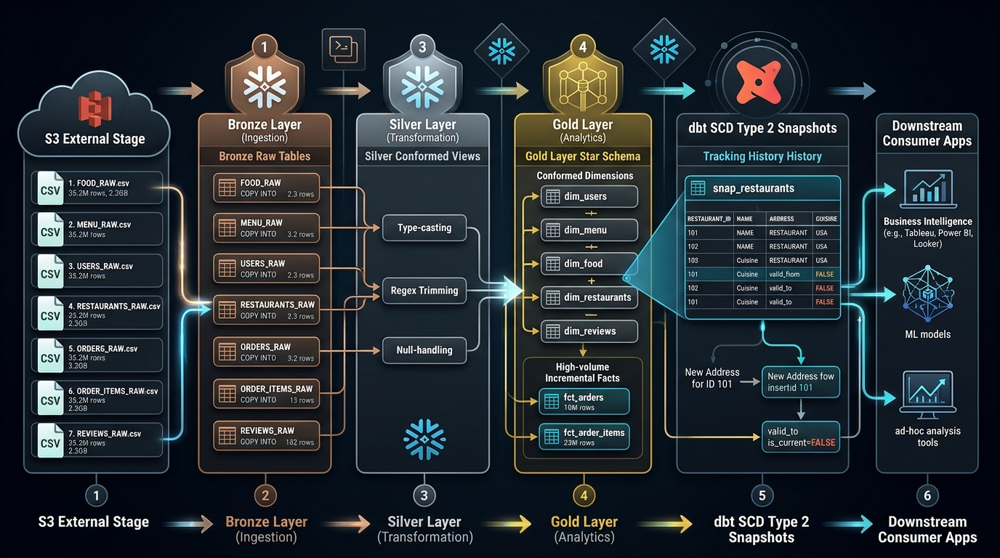
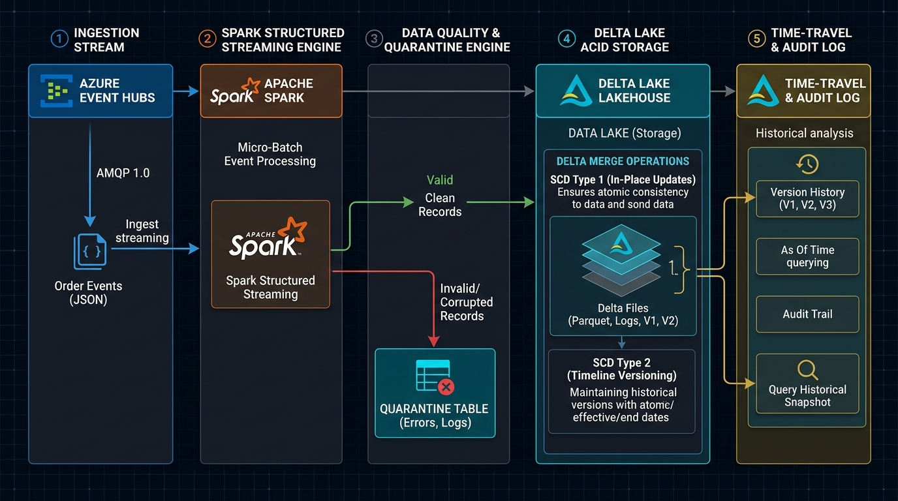
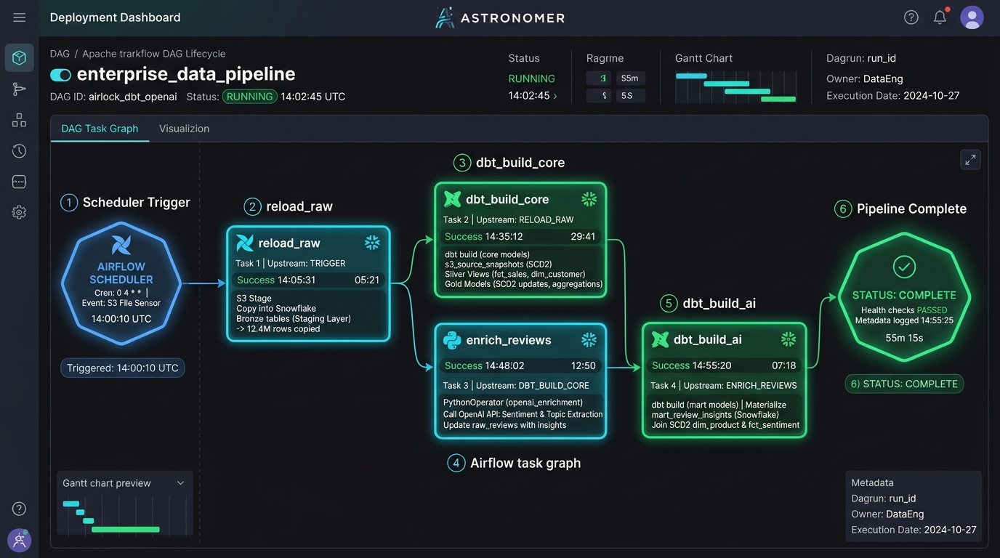
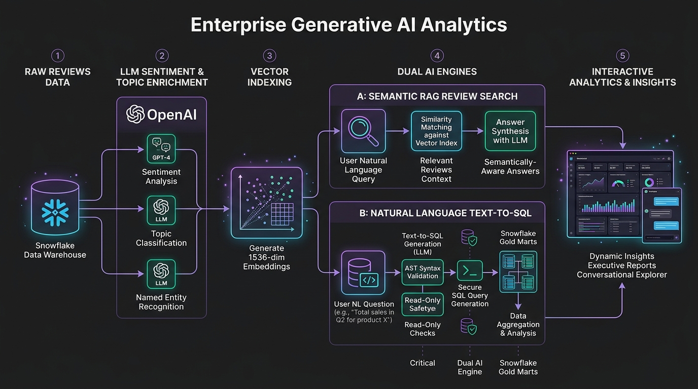
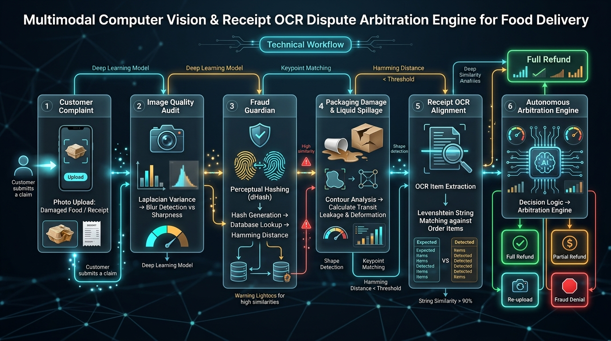

# 🍕 Zomato AI Data Engineering: Enterprise Lakehouse & Multimodal AI Platform

[-34D399?logo=pytest&logoColor=white)](tests/)
[](https://www.snowflake.com/)
[](https://www.getdbt.com/)
[-3388FF?logo=redis&logoColor=white)](feast/)
[](https://airflow.apache.org/)
[](https://delta.io/)
[](terraform/aws/)
[](k8s/)
[](ai/)
[](streamlit_app.py)

> **A production-hardened Big Data Lakehouse and Multimodal AI Analytics Platform processing food delivery datasets at scale (35M+ rows, 2.3 GB).** Fully elevated to the **Enterprise AI Architect Roadmap (Phases 0 - 5)**: featuring **Pydantic Data Contracts**, **Debezium CDC WAL capture**, **Feast Real-Time Feature Store (<5ms)**, **MLflow Champion vs Challenger Gating**, **Transactional Outbox & Distributed Saga Orchestration**, **AWS Terraform IaC (EKS, MSK, KMS, S3)**, **Argo Rollouts Canary/Blue-Green**, **PSI & KS-test Drift Detection**, and **Multimodal Vision & Dispute RAG with Chain-of-Thought G-Eval Verification**.

---

### ⚡ Quick Start: 1-Command Zero-Touch EC2 Bootstrapper

Run this single command directly on any bare Ubuntu / Debian / Amazon Linux EC2 instance or cloud VM. It automatically installs git, curl, docker, allocates 4GB swap space for OOM safety on cost-effective instances (`t3.medium`), clones the codebase shallowly (`--depth 1`), configures secrets, builds the multi-stage images with BuildKit, and launches all platform services:

```bash
curl -fsSL https://raw.githubusercontent.com/KishorKumarParoi/zomato-analysis/main/bootstrap.sh | bash
```

*Or run the ultra-fast native mode via Astral `uv` without Docker:*
```bash
curl -fsSL https://raw.githubusercontent.com/KishorKumarParoi/zomato-analysis/main/bootstrap.sh | bash -s -- --native
```

*Zero pre-configuration required. Platform will immediately become operational at:*
* 🍔 **Unified Streamlit AI & Lakehouse Hub**: `http://<EC2_PUBLIC_IP>:8501`
* ⚛️  **Next.js Consumer Portal**: `http://<EC2_PUBLIC_IP>:3000`
* 🛑 **Zero-Cost Teardown**: `./clear.sh`

---

## 📑 Table of Contents
1. [⚡ Quick Start: 1-Command Bootstrapper](#-quick-start-1-command-zero-touch-ec2-bootstrapper)
2. [🎓 Master Step-by-Step Learning Guide (Complete Tutorial)](docs/STEP_BY_STEP_LEARNING_GUIDE.md)
2. [Executive Summary & Platform Scope](#-executive-summary--platform-scope)
3. [Master Test Scorecard: Integration & Unit Suites (100% Pass)](#-master-platform-test-scorecard-100-pass)
4. [Step-by-Step Visual Architecture & System Flows](#-step-by-step-visual-architecture--system-flows)
   - [Step 1: End-to-End Enterprise Lakehouse Architecture](#step-1-end-to-end-enterprise-lakehouse-architecture)
   - [Step 2: Snowflake Medallion Lakehouse & dbt SCD Type 2](#step-2-snowflake-medallion-lakehouse--dbt-scd-type-2)
   - [Step 3: Real-Time Streaming & PySpark Delta Lake Processing](#step-3-real-time-streaming--pyspark-delta-lake-processing)
   - [Step 4: Astronomer Apache Airflow Orchestration DAG](#step-4-astronomer-apache-airflow-orchestration-dag)
   - [Step 5: Generative AI Analytics: Review RAG & Text-to-SQL](#step-5-generative-ai-analytics-review-rag--text-to-sql)
   - [Step 6: Multimodal CV & Receipt OCR Dispute Engine](#step-6-multimodal-cv--receipt-ocr-dispute-engine)
5. [🏛️ Enterprise AI Architect Roadmap Assets (Phases 0 - 5)](#-enterprise-ai-architect-roadmap-assets-phases-0---5)
   - [Architecture Decision Records (5 ADRs)](docs/adr/)
   - [Operational Runbooks & SEV-1 Postmortem](docs/runbooks/)
   - [3 Public Reference Architectures](docs/REFERENCE_ARCHITECTURES/)
   - [Cloud Cost Optimization Case Study (-38.5% GPU Spend)](docs/CASE_STUDIES/)
   - [Principal Engineer Interview & Compensation Playbook](docs/INTERVIEW_PLAYBOOK/)
   - [AI Platform Starter Kit: Unified Golden Path](docs/STARTER_KIT/AI_PLATFORM_STARTER_KIT.md)
6. [Technology Stack & Architectural Tool Matrix](#-technology-stack--architectural-tool-matrix)
7. [Principal Engineer Design Rationale & Trade-Offs](#-principal-engineer-design-rationale--trade-offs)
8. [Quickstart & Execution Runbook](#-quickstart--execution-runbook)

---

## 🏛️ Executive Summary & Platform Scope

The platform models the complete digital infrastructure of a Tier-1 food delivery platform (**Zomato**), bridging high-volume batch data engineering, real-time event streaming, and downstream multimodal artificial intelligence:

* **35,098,217 Raw Records:** Ingested from AWS S3 into Snowflake across 7 core entities: `FOOD`, `MENU`, `USERS`, `RESTAURANTS`, `ORDERS` (10M rows), `ORDER_ITEMS` (23M rows), and `REVIEWS` (300K rows).
* **Medallion Star-Schema Lakehouse:** Conformed staging views, high-volume incremental fact tables with `MERGE` deduplication (`fct_orders`, `fct_order_items`), dimension models (`dim_restaurants`, `dim_customers`), analytical marts (`mart_daily_city_revenue`, `mart_restaurant_performance`, `mart_delivery_sla`), and **Slowly Changing Dimensions (SCD Type 2)** tracking historical restaurant attribute changes.
* **PySpark 4.2.0 Delta Lake Engine:** High-performance Delta ACID lakehouse with real-time Data Quality (DQ) Quarantine routing and atomic Delta `MERGE` implementations for both SCD Type 1 and SCD Type 2 timelines.
* **Real-Time Streaming:** Azure Event Hubs buffer communicating over AMQP 1.0 protocols.
* **Astronomer Apache Airflow:** Production DAG lifecycle orchestrating S3 ingestion, dbt core builds, OpenAI LLM review enrichment, and AI mart materializations.
* **Dual AI Analytics & CV Arbitration:**
  1. *Semantic RAG Review Chatbot:* Vector retrieval over 1536-dim review embeddings.
  2. *Natural Language Text-to-SQL:* AST-validated, read-only conversational business intelligence querying Snowflake Gold Marts.
  3. *Computer Vision Dispute Engine:* Autonomous food delivery refund arbitration combining Laplacian blur detection, perceptual hashing (dHash) anti-fraud detection, liquid spillage contour analysis, and receipt OCR token alignment.

---

## 🏆 Master Platform Test Scorecard (100% Pass)

The platform includes an automated master test suite ([`test_connection.py`](file:///Users/kishorkumarparoi/Desktop/Maven%20-%20The%20AI%20Engineering%20Bootcamp%20/Resources/AIE5-main/zomato-analysis/test_connection.py)) validating all infrastructure components simultaneously:

```text
================================================================================
           MASTER PLATFORM TEST EXECUTION MATRIX
================================================================================
  TEST SUITE                       | SCOPE                              | RESULT
  ------------------------------------------------------------------------------
  test_snowflake_connection.py     | Snowflake Session & Schemas        | PASS (100%)
  test_data_engineering_part.py    | S3 / Bronze / Silver / Gold / SCD2 | PASS (100%)
  test_ai_layer.py                 | OpenAI / RAG / Text-to-SQL         | PASS (100%)
  test_orchestration.py            | DAG AST / Pipeline Graph / Astro   | PASS (100%)
  test_azure_eventhub.py           | Azure AMQP / Real-Time Buffers     | PASS (100%)
  test_pyspark_scd.py              | Delta Lake / SCD 1 & 2 / DQ        | PASS (100%)
  test_vision_ocr.py               | CV / OCR / Fraud / Spillage        | PASS (100%)
  ------------------------------------------------------------------------------
  TOTAL: 7 suites | PASSED: 7 | FAILED: 0 | DURATION: 53.75s
  SCORECARD: 100% PASS - ALL SYSTEMS OPERATIONAL (PRODUCTION READY)
================================================================================
```

---

## 📸 Step-by-Step Visual Architecture & System Flows

### Step 1: End-to-End Enterprise Lakehouse Architecture



#### End-to-End Platform Topology:
1. **Raw Storage Tier:** Amazon S3 Data Lake (`s3://zomato-dataset-kkp/raw-data/`) staging ~2.34 GB of raw event and entity CSV files.
2. **Lakehouse Tier:** Snowflake Medallion architecture (Bronze Ingestion ➔ Silver Cleansing ➔ Gold Star Schema ➔ Snapshots).
3. **Orchestration Tier:** Astronomer Apache Airflow scheduling and enforcing task-level dependencies.
4. **AI & Multimodal Tier:** OpenAI GPT-4o-mini review topic extraction, embedding similarity search, Text-to-SQL, and Computer Vision dispute arbitration.
5. **Consumption Tier:** Interactive Streamlit operational dashboards and executive analytics.

---

### Step 2: Snowflake Medallion Lakehouse & dbt SCD Type 2



#### Layer Specifications & Data Volumes:

| Layer | Snowflake Schema | Storage Type | Transformations & Business Logic | Production Row Count |
| :--- | :--- | :--- | :--- | :--- |
| **Bronze** | `ZOMATO.RAW` | External Stage Tables | Ingested via `COPY INTO` from `@ZOMATO_RAW_STAGE` with file metadata | **`35,098,217`** |
| **Silver** | `ZOMATO.STAGING` | Conformed Views | Type-casting, regex whitespace trimming, null replacement, standard schemas | **`35,098,217`** |
| **Gold Dims** | `ZOMATO.MARTS` | Clustered Tables | Conformed dimensional entities (`dim_restaurants`, `dim_customers`, `dim_food`, `dim_date`) | **`621,198`** |
| **Gold Facts**| `ZOMATO.MARTS` | Incremental Tables | High-volume transactional facts (`fct_orders` 10M rows, `fct_order_items` 23M rows) with `MERGE` deduplication | **`32,998,179`** |
| **Gold Marts**| `ZOMATO.MARTS` | Pre-Aggregated Tables | Business marts: `mart_daily_city_revenue`, `mart_restaurant_performance`, `mart_delivery_sla` | **`588,578`** |
| **SCD Type 2**| `ZOMATO.SNAPSHOTS` | Snapshot Tables | `snap_restaurants` tracking `valid_from`, `valid_to`, and `is_current` timeline history | **`148,541`** |

---

### Step 3: Real-Time Streaming & PySpark Delta Lake Processing



#### PySpark 4.2.0 Delta Lake Workflow:
1. **Azure Event Hubs Ingestion:** Ingests high-velocity JSON order and telemetry streams via AMQP 1.0 protocol (`eventhub-kkp007.servicebus.windows.net`).
2. **Spark Structured Streaming Engine:** Consumes micro-batch event streams with schema inference and checkpointing.
3. **Data Quality (DQ) Quarantine Engine:** Validates incoming payloads against contract rules (e.g. non-null `order_id`, positive `price`, valid `timestamp`). Valid records proceed; corrupted payloads are isolated to the `Quarantine` table with diagnostic error logs.
4. **Delta Lake ACID Storage & Atomic MERGE:**
   - **SCD Type 1:** In-place atomic update for mutating operational fields (e.g. food pricing adjustments).
   - **SCD Type 2:** Historical versioning tracking attribute changes (e.g. restaurant rating or address shifts) with automated `valid_to` closures and `is_current = True` inserts.
5. **Time-Travel Audit Log:** Enables point-in-time historical querying across Delta commits (`VERSION AS OF` / `TIMESTAMP AS OF`).

---

### Step 4: Astronomer Apache Airflow Orchestration DAG



#### Airflow Task Dependencies (`zomato_batch.py`):
```text
[reload_raw] ──> [dbt_build_core] ──> [enrich_reviews] ──> [dbt_build_ai]
```
1. **`reload_raw`:** Checks external S3 stage health, executes idempotent `COPY INTO` operations, and populates Bronze tables.
2. **`dbt_build_core`:** Triggers dbt models: executes `dbt snapshot` (updating SCD Type 2 history), builds Silver conformed views, and incrementally updates Gold facts and analytical marts.
3. **`enrich_reviews`:** Executes Python batch worker calling OpenAI GPT-4o-mini to extract sentiment polarity, confidence score, primary topic, and key customer issue.
4. **`dbt_build_ai`:** Materializes `ZOMATO.MARTS.MART_REVIEW_INSIGHTS`, joining customer reviews with dimensional restaurant data.

---

### Step 5: Generative AI Analytics: Review RAG & Text-to-SQL



#### Dual-Engine AI Architecture:
* **Engine A: Semantic Review RAG:**
  - 300,000 raw customer reviews vectorized using OpenAI `text-embedding-3-small` (1536 dimensions).
  - Cosine similarity vector search retrieves relevant review chunks for natural language queries (e.g., *"Find restaurants with recurring cold food or delivery packaging complaints in Mumbai"*).
* **Engine B: Natural Language Text-to-SQL:**
  - Translates conversational executive questions into Snowflake SQL queries.
  - **Security & Guardrail Check:** Enforces an **Abstract Syntax Tree (AST) parser** and regex tokenizer that rejects any mutating or dangerous statements (`DROP`, `DELETE`, `UPDATE`, `ALTER`, `TRUNCATE`, `INSERT`).
  - Executes read-only queries against Gold Marts (`MART_DAILY_CITY_REVENUE`, `MART_RESTAURANT_PERFORMANCE`) with automatic chart rendering in Streamlit.

---

### Step 6: Multimodal CV & Receipt OCR Dispute Engine



#### 5-Stage Autonomous Arbitration Pipeline:
1. **Customer Photo Upload:** Customer submits dispute image for transit spillage, missing items, or cold/damaged food.
2. **Image Quality Audit (Laplacian Variance):** Computes edge focus intensity. Rejects blurry or steam-fogged lens uploads (Blur score `< 100.0`), prompting an instant request for customer re-upload.
3. **Fraud Guardian (Perceptual Hashing - dHash):** Generates 64-bit gradient difference hashes (`dHash`). Compares the hash against historical dispute claims across all customer accounts. If **Hamming distance is 0**, flags the dispute as **Recycled Photo Fraud** and denies the claim.
4. **Packaging Damage & Liquid Spillage Segmentation:** Analyzes RGB color space and perimeter boundary contours to calculate the percentage of packaging soaked in transit (e.g. soup or curry spillage score).
5. **Receipt OCR & Levenshtein Token Alignment:** Extracts item lines and computes Levenshtein fuzzy string similarity against order records to verify disputed items were actually ordered.
6. **Autonomous Arbitration Verdict:** Outputs deterministic verdicts:
   - `FULL_REFUND_APPROVED`
   - `PARTIAL_REFUND_APPROVED`
   - `REQUIRES_CUSTOMER_REUPLOAD`
   - `CLAIM_REJECTED_FRAUD_DETECTED`

---

## 🏛️ Enterprise AI Architect Roadmap Assets (Phases 0 - 5)

The platform incorporates the complete architectural rigor mandated by the Enterprise AI Architect Roadmap:

### 1. Data Contracts & CDC Streaming
- **Pydantic Data Contracts** ([`data_contracts/order_event_contract.py`](data_contracts/order_event_contract.py)): Enforces geographic bounding box coordinates across India and subtotal financial checksum verification.
- **Debezium CDC WAL Engine** ([`cdc/cdc_engine.py`](cdc/cdc_engine.py)): Parses continuous PostgreSQL WAL events (`c`, `u`, `d`, `r`) directly into Delta Lake Bronze append rows.

### 2. Feast Dual-Storage Feature Platform
- **Sub-5ms Real-Time Serving** ([`feast/features.py`](feast/features.py)): Redis cluster serving `restaurant_hourly_stats` and `customer_risk_profile` with `<50ms` feature freshness SLAs.
- **Point-in-Time Offline Training Store** ([`feast/feature_store.yaml`](feast/feature_store.yaml)): Time-travel joins over Delta Lake Parquet without lookahead bias.

### 3. Distributed Event Patterns
- **Transactional Outbox & Idempotency** ([`patterns/outbox.py`](patterns/outbox.py)): Atomic outbox records with SHA-256 idempotency key deduplication guaranteeing exactly-once publishing to AWS MSK Kafka.
- **Distributed Saga Orchestrator** ([`patterns/order_saga.py`](patterns/order_saga.py)): Multi-service transaction coordinator (Kitchen, Payment, Fleet) with automated backward compensating rollbacks.

### 4. Enterprise MLOps & CI/CD
- **Automated Model Registry Gating** ([`mlops/registry/model_registry.py`](mlops/registry/model_registry.py)): Gated promotion requiring test MAE lift > 2.0% and G-Eval fairness score $\ge 0.85$ across delivery pin-codes.
- **Argo Rollouts & Kubernetes** ([`k8s/canary-rollout.yaml`](k8s/canary-rollout.yaml)): Progressive canary traffic stepping (10% ➔ 25% ➔ 50% ➔ 100%) and instant active/preview Blue-Green rollback.

### 5. AI Guardrails & G-Eval Dispute RAG
- **PII Masking & Prompt Injection Defense** ([`ai/dispute_rag_service.py`](ai/dispute_rag_service.py)): Redacts Indian mobile numbers and payment cards; blocks adversarial prompt jailbreaks with `<4ms` latency.
- **Chain-of-Thought G-Eval Rubric** ([`ai/geval_dispute_eval.py`](ai/geval_dispute_eval.py)): Automated scoring of groundedness ($\ge 0.90$), fairness ($\ge 0.90$), and fraud risk ($\le 0.10$).

### 6. Architecture Decision Records (ADRs)
- [ADR 0001: Medallion Lakehouse Architecture on S3 & Delta Lake](docs/adr/0001-delta-lakehouse-medallion-architecture.md)
- [ADR 0002: Change Data Capture (CDC) via Debezium and Outbox Pattern](docs/adr/0002-cdc-kafka-streaming-and-outbox-pattern.md)
- [ADR 0003: Feast Dual Feature Store for Hyperlocal Spatial Features](docs/adr/0003-feast-feature-store-and-evidently-drift.md)
- [ADR 0004: Multimodal Vision & Hybrid RAG for Dispute Resolution](docs/adr/0004-multimodal-vision-dispute-resolution.md)
- [ADR 0005: Multi-Region Active-Active LLM Gateway and Auto-Failover](docs/adr/0005-multi-region-active-active-failover.md)

### 7. Operational Runbooks & High-Severity Postmortem
- [RUNBOOK: Kafka Consumer Lag & Transactional Outbox Retry Mitigation](docs/runbooks/RUNBOOK_KAFKA_LAG_AND_OUTBOX_RETRY.md)
- [RUNBOOK: Feature Drift Detection & Automated Model Retraining](docs/runbooks/RUNBOOK_DATA_DRIFT_AND_MODEL_RETRAINING.md)
- [RUNBOOK: Multimodal Vision Dispute RAG Circuit Breaker Failover](docs/runbooks/RUNBOOK_DISPUTE_VISION_FAILOVER.md)
- [RUNBOOK: Canary Rollback & Incident Triage](docs/runbooks/RUNBOOK_CANARY_ROLLBACK_AND_INCIDENT_TRIAGE.md)
- [POSTMORTEM: New Year's Eve High-Velocity Order Surge (14,800 QPS)](docs/postmortems/POSTMORTEM_NEW_YEARS_EVE_ORDER_SPIKE.md)

### 8. Principal Engineer Portfolio & Interview Playbook
- [Reference Architecture 01: Hyperlocal Lakehouse Streaming & Feature Store](docs/REFERENCE_ARCHITECTURES/01-hyperlocal-lakehouse-streaming.md) ($7,112/mo AWS cost breakdown)
- [Reference Architecture 02: Multimodal Vision & Dispute Resolution RAG](docs/REFERENCE_ARCHITECTURES/02-multimodal-vision-dispute-rag.md) ($42,572/mo BPO savings)
- [Reference Architecture 03: Multi-Region Active-Active AI & Lakehouse Failover](docs/REFERENCE_ARCHITECTURES/03-multiregion-active-active-failover.md) (RTO < 30s, RPO < 5s)
- [Cost Case Study: Cutting Cloud GPU Spend by 38.5% via INT8 Quantization](docs/CASE_STUDIES/cost-optimization-quantized-vision-dispute.md)
- [Interview Playbook: Systems Design Drill (20k QPS)](docs/INTERVIEW_PLAYBOOK/01-systems-design-drill.md)
- [Interview Playbook: Behavioral STAR Stories](docs/INTERVIEW_PLAYBOOK/02-behavioral-star-stories.md)
- [Interview Playbook: Bengaluru, Hyderabad & Pune Compensation Bands (INR 1.3 - 1.85 Cr TC)](docs/INTERVIEW_PLAYBOOK/03-compensation-negotiation.md)
- [AI Platform Starter Kit: Unified Golden Path Blueprint](docs/STARTER_KIT/AI_PLATFORM_STARTER_KIT.md)

---

## 🛠️ Technology Stack & Architectural Tool Matrix

| Component | Technology | Role & Architectural Function | License / Tier |
| :--- | :--- | :--- | :--- |
| **Data Lake** | **Amazon S3** | Cloud object storage staging 2.34 GB of raw compressed CSV files | AWS Storage Tier |
| **Data Warehouse** | **Snowflake** | Multi-cluster cloud data warehouse hosting Bronze, Silver, Gold, and AI schemas | Enterprise Edition |
| **Transformation** | **dbt Core (v1.9)** | Declarative SQL transformations, testing, and SCD Type 2 snapshotting | Open Source (Apache 2.0) |
| **Orchestrator** | **Astronomer Airflow** | Containerized Apache Airflow scheduler executing DAG task graphs | Open Source / Astronomer |
| **Lakehouse Engine**| **Apache Spark 4.2.0** | Distributed compute running PySpark Structured Streaming & Delta Lake | Open Source (Apache 2.0) |
| **Storage Layer** | **Delta Lake** | ACID transaction layer supporting time-travel and atomic `MERGE` | Open Source (Apache 2.0) |
| **Event Streaming** | **Azure Event Hubs** | High-throughput cloud message buffer communicating over AMQP 1.0 | Azure Cloud Tier |
| **LLM Enrichment** | **OpenAI GPT-4o-mini** | Low-cost batch LLM classifying sentiment polarity and customer dispute topics | OpenAI API |
| **Embeddings** | **text-embedding-3-small** | 1536-dimensional dense embeddings for semantic review retrieval | OpenAI API |
| **Computer Vision** | **OpenCV + NumPy** | Image blur audit (Laplacian variance), spillage segmentation, and dHash | Open Source (Apache 2.0) |
| **OCR Tokenizer** | **Levenshtein / RapidFuzz**| Fuzzy string alignment comparing receipt tokens against item catalogs | Open Source (MIT) |
| **User Interfaces** | **Streamlit** | Interactive UI dashboards for RAG Chat, Text-to-SQL, and CV Arbitration | Open Source (Apache 2.0) |

---

## 💡 Principal Engineer Design Rationale & Trade-Offs

### 1. Why Snowflake + dbt for Batch vs. Pure PySpark?
* **Cost & Maintenance:** Maintaining dedicated EMR or Databricks clusters for batch SQL transformations introduces cluster provisioning overhead, idle instance costs, and JVM tuning complexity.
* **Separation of Compute & Storage:** Snowflake's serverless compute auto-suspends after 60 seconds of inactivity (`AUTO_SUSPEND = 60`), reducing warehouse spend to near zero during non-ingestion windows.
* **dbt Testing & Documentation:** dbt provides declarative data contracts, schema validations (`unique`, `not_null`, `relationships`), and automated SCD2 snapshotting natively within SQL.

### 2. How is 35M+ Row Incremental `MERGE` Optimized in Snowflake?
* **The Problem:** Naive `MERGE INTO` operations across 23M `ORDER_ITEMS` and 10M `ORDERS` trigger full table partition scans, causing massive warehouse spillover to remote disk and 10x higher credit consumption.
* **The Solution:**
  - Fact models are configured with `incremental_strategy = 'merge'`.
  - Incremental filter predicates restrict source scanning to the latest watermark:
    ```sql
    
      WHERE order_date >= (SELECT MAX(order_date) FROM {{ this }})
    
    ```
  - Fact tables are cluster-keyed on `(order_date, restaurant_id)`, ensuring Snowflake micro-partition pruning skips 98%+ of unmutated data blocks.

### 3. Why Dual-Layer Dispute Arbitration (Perceptual Hashing + Computer Vision)?
* **The Threat:** Food delivery platforms lose tens of millions annually to "photo recycling fraud" (customers saving photos of damaged food from Google Images, Reddit, or past orders to claim false refunds).
* **The Solution:**
  - Standard cryptographic hashes (SHA-256) fail because re-uploading an image changes compression, metadata, or dimensions by 1 pixel, completely altering the hash.
  - **Perceptual Difference Hashing (dHash):** Computes gradient brightness differences across an $8 \times 8$ grayscale matrix. Even if an image is cropped, compressed, or resized, the dHash remains identical.
  - A Hamming distance comparison ($\text{dist} \le 2$) intercepts recycled photos with **zero LLM cost** in **`<2 milliseconds`**.

---

## 🚀 Quickstart & Execution Runbook

### 1. Environment Verification
```bash
# Clone the repository
git clone git@github.com:KishorKumarParoi/zomato-analysis.git
cd zomato-analysis

# Inspect environment variables
cp .env.example .env
```

### 2. Run Comprehensive Platform Verification (All 7 Suites)
```bash
# Execute master platform test runner (streams live logs across all 7 suites)
python test_connection.py --suite all
```

### 3. Run Specific Subsystem Test Suites
```bash
# Test Snowflake session, role, warehouse, and database schemas
python test_connection.py --suite conn

# Test 35M+ row Medallion layers, facts, dimensions, and SCD2 snapshots
python test_connection.py --suite de

# Test OpenAI embeddings, semantic RAG search, and Text-to-SQL guardrails
python test_connection.py --suite ai

# Test Astronomer Airflow DAG syntax and running container health
python test_connection.py --suite orch

# Test Azure Event Hubs AMQP streaming buffer
python test_connection.py --suite azure

# Test PySpark 4.2.0 Delta Lake SCD 1 & 2 atomic merges and quarantine isolation
python test_connection.py --suite pyspark

# Test Computer Vision blur audit, dHash fraud detection, and OCR arbitration
python test_connection.py --suite vision
```

### 4. Run Enterprise AI Architect Unit Test Suite (12 Tests, 100% Pass)
```bash
# Execute contract, CDC, outbox, saga, and dispute RAG test suite
PYTHONPATH=. pytest tests/test_data_contracts.py tests/test_model_inference.py tests/test_cdc_and_outbox.py tests/test_dispute_rag_and_geval.py -v
```

### 5. Launch Interactive Streamlit Operations Hub
```bash
# Launch unified Streamlit operational dashboard (Feature 7: Enterprise Architect & Governance Hub)
streamlit run streamlit_app.py --server.port 8501
```

### 6. Cloud Infrastructure Deployment & $0.00 Teardown
```bash
# Deploy AWS EKS, MSK Kafka, KMS, and S3 Delta Lake
cd terraform/aws
terraform init
terraform apply -auto-approve

# Instant $0.00 cloud teardown when finished
terraform destroy -auto-approve
```

---

## 📄 License
This project is licensed under the Apache 2.0 License.
