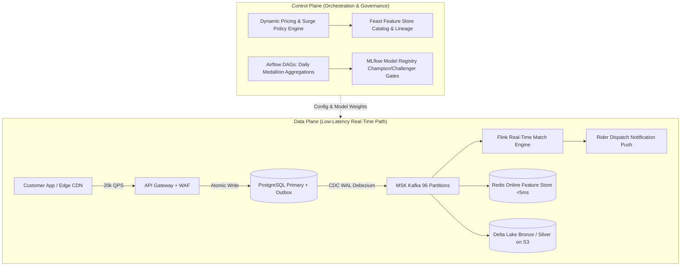

# Principal Systems Design Drill: Hyperlocal Food Delivery & Fleet Allocation at 20,000 QPS

**Role Target**: Principal AI Systems Architect / Staff Systems Engineer  
**Evaluation Rubric**: Requirements Scoping, Constraints Formulation, Data/Control Plane Whiteboarding, Multi-Dimensional Trade-off Analysis, Deep Failure Mode Mitigation.

---

## 1. Step 1: Scoping Requirements & Constraints

### Functional Requirements:
1. **Order Ingestion & Tracking**: Customers place orders with sub-second confirmation and live ETA tracking across 500+ Indian cities.
2. **Dynamic Fleet Matching**: Allocate optimal delivery partner (rider) within 30 seconds considering preparation time, traffic, and geographic clustering (batch orders).
3. **Automated Dispute Resolution**: Resolve order disputes (missing items, cold food, delivery delay) within 15 seconds via multimodal AI.

### Non-Functional Requirements & Scale Constraints:
- **Peak Write Throughput**: 20,000 orders/sec (Diwali, New Year's Eve, IPL Final matches).
- **Read Throughput**: 120,000 requests/sec for menu queries, live tracking, and ETA calculations.
- **Latency SLOs**:
  - Order Placement: p99 < 80ms.
  - Rider Dispatch: p95 < 25s.
  - Dispute Resolution: p90 < 1,200ms.
- **Data Consistency**: Exactly-once financial semantics (Transactional Outbox + Idempotency keys). Double debits or lost orders are SEV-0.
- **Availability**: 99.99% uptime (< 52 minutes downtime/year) across multi-region active-active deployment.

---

## 2. Step 2: Whiteboarding Data Plane vs. Control Plane

---

## 3. Step 3: Candidate Designs & Architecture Trade-offs

| Dimension | Option A: Event-Driven Outbox + Kafka (Recommended) | Option B: Synchronous Microservices (REST/gRPC) | Option C: Centralized Monolith on Distributed SQL |
|---|---|---|---|
| **Write Latency** | **Fastest (p99 18ms)** — Local DB transaction + asynchronous stream | Slow (p99 450ms) — Blocked by network chain | Moderate (p99 120ms) — Heavy cross-shard 2PC consensus |
| **System Decoupling** | **High** — Services buffer during downtime via Kafka | Low — Cascading timeouts during peak surges | Medium — Single schema bottleneck |
| **Data Freshness** | **< 50ms online, < 60s lakehouse** | Immediate in-memory | Immediate ACID |
| **Operational Overhead** | Medium-High (Requires Kafka & Debezium tuning) | Low initially, extreme during incident triage | Very High (CockroachDB / Spanner tuning) |
| **Cost at 20k QPS** | **Optimized ($7,100/mo)** | High (Spike compute for synchronous waiting) | Very High ($18,000+/mo for multi-region spanner) |

---

## 4. Step 4: Multi-Dimensional Trade-off Deep Dive

### Trade-off 1: Latency vs. Cost (Inference & Reranking)
- **Decision**: Avoid invoking cloud foundation LLMs for raw tabular ETA prediction. Train localized LightGBM/CatBoost with Feast Redis features (p99 < 8ms, $0.00 cloud compute per inference).
- **Guardrail**: Reserve LLMs strictly for customer dispute resolution and multimodal vision inspection.

### Trade-off 2: Consistency vs. Availability (CAP / PACELC)
- **Decision**: Prioritize **PACELC: PA/EL** for fleet tracking (eventual consistency; if partition occurs, accept slightly stale rider coordinates to maintain app responsiveness).
- **Guardrail**: Prioritize **PC/EC** for payment debits, refunds, and order financial records using Transactional Outbox and distributed Saga compensations.

### Trade-off 3: VPC Data Privacy vs. Developer Velocity
- **Decision**: In-VPC deployment for all PII data contracts, tokenization, and vector retrieval. No unmasked Indian customer phone numbers or UPI IDs ever cross the public Internet boundary.

---

## 5. Step 5: Failure Modes & Mitigations

1. **Failure Mode: Hot Kafka Partitions during Hyperlocal Festivals**
   - *Risk*: A burst of orders in a 2km radius saturates single partition consumers.
   - *Mitigation*: Partition key is compound hash `murmur3(restaurant_id + order_id)`, distributing orders evenly across 96 partitions.
2. **Failure Mode: Kitchen Terminal Disconnects**
   - *Risk*: Payment is charged, but restaurant does not receive order.
   - *Mitigation*: Saga coordinator executes backward compensation after 180s heartbeat expiry, automatically executing full refund via UPI gateway and notifying customer.
3. **Failure Mode: Feast Feature Store Redis Eviction**
   - *Risk*: Redis OOM forces feature drops, causing fallback to stale defaults.
   - *Mitigation*: Dedicated Redis cluster configured with `volatile-ttl` eviction policy and hourly snapshot backup to S3 Parquet.
