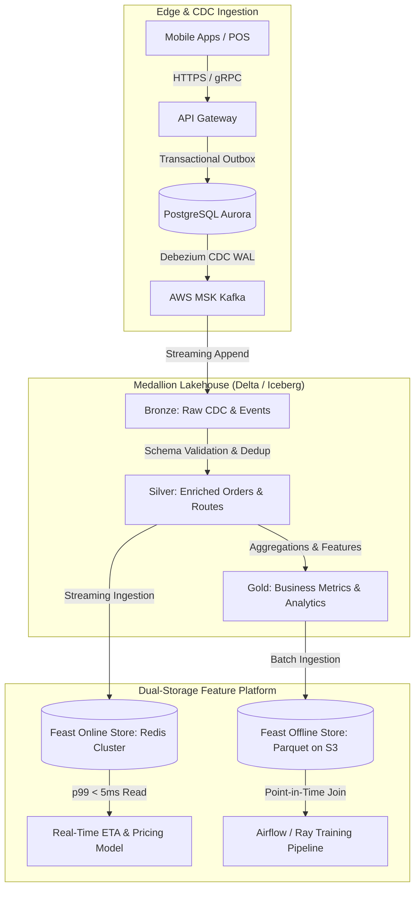

# Reference Architecture 01: Hyperlocal Streaming Lakehouse & Feature Store

**Domain**: Real-Time Order Telemetry, Spatial ETA Scoring, and Medallion Analytics  
**Scale**: 15,000 QPS Peak, 12 TB Daily Ingestion, 350 Million Monthly Orders  
**Target Infrastructure**: AWS (MSK, EKS, S3, RDS Aurora PostgreSQL) + Apache Iceberg / Delta Lake

---

## 1. Architectural Blueprint & Topology

---

## 2. Freshness & Latency Service Level Objectives (SLOs)

| Layer | Freshness SLA | Latency Target | Processing Engine | Storage Format |
|---|---|---|---|---|
| **Online Feature Store** | < 50 milliseconds | p99 < 8 ms | Flink / Redis Stream Worker | Redis In-Memory Cluster |
| **Bronze Layer** | < 30 seconds | p99 < 15 s | Debezium + Spark Streaming | Delta Lake (Append-Only) |
| **Silver Layer** | < 60 seconds | p99 < 45 s | Spark Structured Streaming / Delta Live | Delta Lake (Upsert / Merge) |
| **Gold Layer** | < 1 hour | Batch run 15m | Apache Airflow / dbt Core | Delta Lake / S3 Parquet |

---

## 3. Architecture Decision Records (ADRs) Linked
- [ADR 0001: Medallion Lakehouse Architecture on S3 & Delta Lake](../adr/0001-delta-lakehouse-medallion-architecture.md)
- [ADR 0002: Change Data Capture (CDC) via Debezium and Transactional Outbox](../adr/0002-cdc-kafka-streaming-and-outbox-pattern.md)
- [ADR 0003: Feast Dual Feature Store for Hyperlocal Spatial Features](../adr/0003-feast-feature-store-and-evidently-drift.md)

---

## 4. Cost Breakdown & Capacity Plan (Monthly at Scale)

| Component | AWS Resource Specification | Units | Monthly Cost (USD) |
|---|---|---|---|
| **Event Streaming** | Amazon MSK (Kafka) m5.2xlarge | 6 Brokers | $2,160.00 |
| **Lakehouse Storage** | Amazon S3 Intelligent-Tiering (Delta Lake) | 60 TB | $1,280.00 |
| **Online Feature Store** | Amazon ElastiCache Redis cache.r6g.xlarge (Multi-AZ) | 4 Nodes | $1,152.00 |
| **Compute & Consumers** | Amazon EKS Managed Nodes (m6i.xlarge Spot/On-Demand mix) | 16 Nodes | $1,840.00 |
| **ETL & Airflow Orchestration** | MWAA (Managed Workflows for Apache Airflow) Large | 1 Env | $680.00 |
| **Total Platform Spend** | | | **$7,112.00 / mo** |
*Cost per order fulfilled: $0.000203 (0.02 cents per order)*

---

## 5. Security & Isolation Controls
- **KMS Encryption**: All S3 Delta tables encrypted with Customer Managed Key (CMK) rotated annually.
- **IAM IRSA**: Kubernetes pods assume minimal IAM roles with temporary token federation via STS.
- **Data Governance**: Apache Ranger / AWS Lake Formation cell-level security masks customer phone numbers and payment card hashes.
