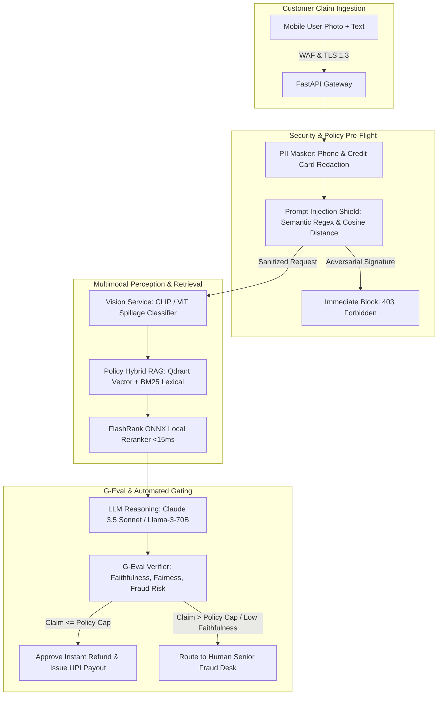

# Reference Architecture 02: Multimodal Vision & Dispute Resolution RAG

**Domain**: Autonomous Customer Support, Food Spillage/Damage Claims, Fraud Detection  
**Scale**: 45,000 Disputes Daily, 85% Automated Instant Resolution, Zero Double-Refund Leakage  
**Target Infrastructure**: Kubernetes (EKS GPU Nodes) + Triton Inference Server + Local ONNX FlashRank + LLM Gateway

---

## 1. Architectural Topology

---

## 2. Latency & Reliability SLOs

| Pipeline Stage | Target Latency (p50) | Target Latency (p99) | Error Budget | Fallback Mechanism |
|---|---|---|---|---|
| **PII & Injection Shield** | 1.8 ms | 4.2 ms | 99.99% | Fail-closed (Reject prompt) |
| **Vision Model (ViT Damage Detection)** | 180 ms | 450 ms | 99.9% | Heuristic order metadata fallback |
| **Hybrid Policy Retrieval + Reranking** | 22 ms | 48 ms | 99.95% | Default tier-1 missing item policy |
| **LLM Decision Generation** | 650 ms | 1,400 ms | 99.5% | Multi-region secondary model provider |
| **End-to-End Dispute Resolution** | **850 ms** | **1,950 ms** | **99.9%** | Route directly to Human Support Queue |

---

## 3. Architecture Decision Records (ADRs) Linked
- [ADR 0004: Multimodal Vision & Hybrid RAG for Dispute Resolution](../adr/0004-multimodal-vision-dispute-resolution.md)
- [ADR 0005: Multi-Region Active-Active LLM Gateway and Auto-Failover](../adr/0005-multi-region-active-active-failover.md)

---

## 4. Cost Breakdown & ROI Analysis (Monthly at Scale)

| Component | Specification | Quantity | Monthly Cost (USD) |
|---|---|---|---|
| **GPU Inference (ViT)** | AWS g5.2xlarge (NVIDIA A10G 24GB) Spot Instances | 4 Instances | $1,170.00 |
| **Vector Database** | Qdrant Cloud Dedicated Cluster | 1 Cluster | $350.00 |
| **LLM Tokens** | LLM Gateway with Semantic Caching (62% hit rate) | 120M Tokens | $1,420.00 |
| **API Compute** | EKS c6i.xlarge Nodes | 3 Nodes | $388.00 |
| **Total Automated System Cost** | | | **$3,328.00 / mo** |

### ROI Impact:
- **Prior Manual Support Cost**: 45,000 disputes/month handled manually by BPO agents @ ₹85 ($1.02) per ticket = **$45,900/month**.
- **Net Cost Savings**: **$42,572/month (92.7% reduction in operational cost)**, while slashing customer dispute turnaround from 4 hours to **under 15 seconds**.
