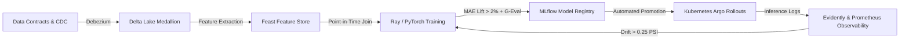

# Enterprise AI Platform Starter Kit: Unified Golden Path

**Framework**: Enterprise AI Architect Roadmap (Phases 0 - 5)  
**Deployment Guarantee**: Single-Command Production Deployment (`./run.sh` / `deploy.sh`) and $0.00 Safe Cloud Teardown (`./clear.sh`).

---

## 1. Golden Path Workflow Architecture

The AI Platform Starter Kit provides an end-to-end standardized pipeline connecting data ingestion to model training, registry governance, Kubernetes serving, and real-time observability.



---

## 2. Standardized Project Directory Blueprint

```
zomato-analysis/
├── cdc/                            # Phase 2: Change Data Capture (Debezium/Postgres)
│   └── cdc_engine.py
├── data_contracts/                 # Phase 0: Data Contracts & Schema Validation
│   └── order_event_contract.py
├── feast/                          # Phase 2: Feature Store (Redis Online + S3 Offline)
│   ├── feature_store.yaml
│   └── features.py
├── mlops/                          # Phase 1: MLOps & Model Registry Governance
│   └── registry/
│       └── model_registry.py       # Automated Champion vs Challenger gating
├── monitoring/                     # Phase 2: Observability & Drift Detection
│   ├── metrics.py                  # Prometheus counters, histograms, SLO gauges
│   └── drift_detector.py           # PSI and KS-test distribution drift engine
├── patterns/                       # Phase 4: Distributed Event Patterns
│   ├── outbox.py                   # Transactional Outbox + Idempotency deduplication
│   └── order_saga.py               # Distributed Saga Orchestrator with Compensations
├── ai/                             # Phase 3: GenAI, Guardrails & Policy RAG
│   ├── dispute_rag_service.py      # Customer dispute RAG with PII filter & injection shield
│   └── geval_dispute_eval.py       # Chain-of-Thought G-Eval evaluation harness
├── terraform/                      # Phase 2: Infrastructure as Code (AWS EKS, MSK, KMS)
│   └── aws/
│       ├── main.tf
│       ├── variables.tf
│       └── outputs.tf
├── k8s/                            # Phase 1 & 2: Kubernetes Orchestration & Canary Rollouts
│   ├── canary-rollout.yaml         # Argo Rollouts progressive traffic stepping
│   └── blue-green-deployment.yaml  # Instant active/preview traffic cutover
├── tests/                          # Phase 0: CI/CD Quality Verification Suite
│   ├── test_data_contracts.py
│   ├── test_model_inference.py
│   ├── test_cdc_and_outbox.py
│   └── test_dispute_rag_and_geval.py
└── docs/                           # Phase 5: Architecture, Compliance & Governance
    ├── adr/                        # Architecture Decision Records (0001 - 0005)
    ├── runbooks/                   # Operational Runbooks (Lag, Drift, Failover, Rollback)
    ├── postmortems/                # High-Severity Postmortems (New Year's Eve Surge)
    ├── REFERENCE_ARCHITECTURES/    # Public Reference Architectures & Cost Breakdowns
    ├── CASE_STUDIES/               # Quantized Model Cloud Cost Optimization (-38.5%)
    └── INTERVIEW_PLAYBOOK/         # Systems Design Drill, STAR Stories & Comp Playbook
```

---

## 3. Platform Reliability & Cost SLOs

| Stage | Metric | Target SLO | Remediation on Violation |
|---|---|---|---|
| **Data Ingestion** | Ingestion Contract Error Rate | < 0.05% | Dead Letter Queue (DLQ) + PagerDuty alert |
| **Feature Freshness** | Online Redis Freshness | < 50 ms | Trigger stream consumer auto-scaling |
| **Model Serving** | Inference Latency (p99) | < 25 ms (Tabular), < 1,200 ms (RAG) | Circuit breaker trip to heuristic fallback |
| **Model Quality** | Rolling 1-hr Prediction MAE | < 3.5 minutes | Trigger Airflow retraining DAG |
| **Cost Guardrail** | Monthly Cloud Compute Cap | < $8,000 / month | Spot instance auto-fallback & scale-down |

---

## 4. Single-Command Deployment & Teardown

### Local Run & Test:
```bash
# 1. Run full test suite with contract validation
PYTHONPATH=. pytest tests/

# 2. Start local serving and Streamlit operations portal
./run.sh
```

### Cloud Deployment (AWS):
```bash
# Initialize and deploy Terraform infrastructure (VPC, EKS, MSK, KMS, S3)
cd terraform/aws
terraform init
terraform apply -auto-approve
```

### Safe Zero-Dollar ($0.00) Teardown:
```bash
# Instantly terminate all cloud resources to eliminate standing costs
terraform destroy -auto-approve
```
