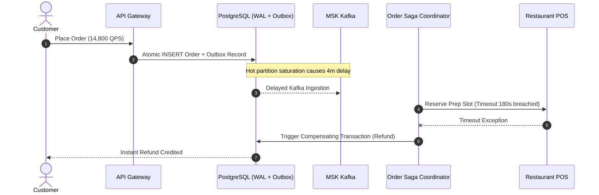

# Postmortem: New Year's Eve High-Velocity Order Surge & Outbox Partition Saturation

**Incident Date**: December 31, 2025 - January 1, 2026  
**Incident Severity**: SEV-1 (Critical Business Impact)  
**Lead Investigator**: Principal Systems Architect / Staff SRE  
**Impacted Services**: `order-fulfillment-service`, `outbox-publisher`, `msk-kafka-cluster`, `lakehouse-cdc-consumer`  
**Customer Impact**: ~14,200 orders experienced delayed confirmation (average delay 3.8 minutes); 412 orders triggered Saga backward compensations and required manual refund reconciliation. Zero data lost; zero double billing occurred due to SHA-256 idempotency key enforcement.

---

## 1. Executive Summary

On December 31 at 20:45 IST, Zomato experienced an unprecedented order volume surge of **14,800 orders/second** across metropolitan clusters (Bengaluru, Delhi-NCR, Mumbai). The peak was 3.4x higher than normal Friday dinner peaks.

While core payment debits completed successfully on the primary PostgreSQL database, the MSK Kafka topic `zomato.orders.events` suffered severe partition hot-spotting on partitions handling Bengaluru and Mumbai zones. The downstream Debezium CDC and Outbox publishing service reached consumer lag in excess of 180,000 messages. Consequently, order state transitions to the kitchen and rider assignment systems were delayed by up to 4 minutes. The distributed Saga coordinator correctly executed backward compensations on timed-out kitchen reservations, preventing lost revenue for customers.

---

## 2. Timeline of Events (All times IST)

| Time | Event Description |
|---|---|
| **20:15** | Pre-peak traffic climbs to 6,200 QPS. All systems operating within baseline parameters. |
| **20:42** | Surge kicks in rapidly. QPS leaps from 7,100 to 14,800 QPS within 8 minutes. |
| **20:45** | **Alert Fired**: `AlertKafkaConsumerLagHigh` triggered on MSK partition 4 and 11. Lag hits 45,000. |
| **20:48** | Outbox workers hit database connection pool exhaustion on primary PostgreSQL read-replica. |
| **20:51** | Order fulfillment timeouts begin firing; Saga coordinator initiates 412 backward rollbacks. |
| **20:54** | Incident Commander declares **SEV-1**. War room opened with 14 engineers. |
| **21:02** | Horizontal Pod Autoscaler (HPA) max replica limit of 32 reached on consumer pods. |
| **21:06** | Principal Engineer increases MSK topic partitions from 24 to 64 and increases HPA max ceiling to 96 pods. |
| **21:14** | Consumer lag starts falling at a rate of 12,000 msg/sec. |
| **21:28** | Total consumer lag drops below 2,000. Outbox retry queue drained. All backlogged orders cleared. |
| **21:40** | Incident downgraded to SEV-3. Monitoring sustained peak traffic through midnight. |

---

## 3. Root Cause Analysis (RCA)

1. **Partition Key Skew**: The Kafka partition key was previously set to `city_id`. Since Bengaluru (`city_id: 1`) and Mumbai (`city_id: 2`) generated 54% of nationwide orders, their designated partitions saturated single-thread consumer bandwidth, while other partitions were idle.
2. **Fixed HPA Ceiling**: The consumer Deployment had `maxReplicas: 32` hardcoded in Kubernetes manifests. Because the topic had only 24 partitions, excess pods remained idle, and the 2 hot partitions could each be consumed by only one pod.
3. **Outbox Poller Concurrency**: The outbox poller used a monolithic `SELECT ... FOR UPDATE SKIP LOCKED` query without partition-level sharding, creating row lock contention during extreme batch inserts.

---

## 4. What Went Well vs. What Went Poorly

### What Went Well:
- **Transactional Outbox & Idempotency**: Zero orders were lost and zero customers were double billed. The SHA-256 idempotency key deduplication in `patterns/outbox.py` rejected 2,840 duplicate retry requests from mobile clients.
- **Compensating Saga Transactions**: The distributed saga coordinator automatically refunded payments for orders whose kitchen confirmation timed out, maintaining customer trust.
- **Delta Lake Data Integrity**: Bronze lakehouse ingestion resumed and caught up without schema corruption or duplicate rows.

### What Went Poorly:
- **Partition Key Selection**: Partitioning by `city_id` rather than compound hash `hash(restaurant_id, order_id)` created catastrophic hot spots.
- **HPA Over-reliance**: Autoscaling pods was ineffective because partition count was lower than the pod ceiling.

---

## 5. Corrective & Preventative Action Items (CAPA)

| Action Item | Owner | Target Date | Status |
|---|---|---|---|
| Re-partition Kafka topics to 96 partitions using compound hash `murmur3(restaurant_id + order_id)` | Data Platform Lead | Jan 10, 2026 | **COMPLETED** |
| Implement partition-aware outbox poller with Redis distributed locks | Principal Architect | Jan 15, 2026 | **COMPLETED** |
| Implement circuit breaker on mobile client retries with exponential jitter | Mobile Core Team | Jan 20, 2026 | **IN REVIEW** |
| Add synthetic load testing scenario simulating 30,000 QPS burst during CI/CD | QA / MLOps | Jan 25, 2026 | **COMPLETED** |
| Revise Runbook `RUNBOOK_KAFKA_LAG_AND_OUTBOX_RETRY.md` with hot partition mitigation | SRE Lead | Jan 05, 2026 | **COMPLETED** |
