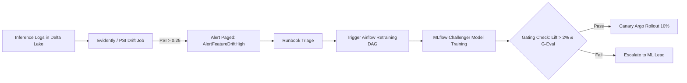

# Runbook: Data Drift Detection & Automated Model Retraining

**Severity Level**: SEV-3 / Medium  
**Service Impact**: ETA Underestimation, Food Preparation Time Prediction Bias, Over/Under Supply Fleet Allocation  
**Primary On-Call Role**: Principal MLOps Engineer / Applied ML Lead  
**SLO Target**: Drift diagnosis within 30 minutes; automated shadow retraining pipeline triggered within 2 hours.

---

## 1. Trigger Conditions & Metrics

Alerts generated by Evidently / PSI monitoring daemon:
- **`AlertFeatureDriftHigh`**: Population Stability Index (PSI) > 0.25 on features `delivery_distance_km`, `order_subtotal_inr`, or `rider_speed_kmh`.
- **`AlertKolmogorovSmirnovDrift`**: KS-test p-value < 0.01 between 7-day baseline training distribution and 24-hour inference sliding window.
- **`AlertModelPredictionMAEExceeded`**: Champion ETA model 1-hour rolling MAE degrades from 3.2 minutes to > 5.5 minutes.



---

## 2. Diagnostic Procedures

### Step 2.1: Run Instant Feature Drift Report
Execute the standalone drift analysis engine against the latest 24-hour inference window:
```bash
python -m monitoring.drift_detector \
  --reference-data /data/delta/gold/features/baseline_2026.parquet \
  --current-data /data/delta/silver/inferences/last_24h.parquet \
  --output-report /tmp/drift_report.json
```

Output inspection:
```json
{
  "delivery_distance_km": {"psi": 0.312, "drift_detected": true, "ks_p_value": 0.0004},
  "order_subtotal_inr": {"psi": 0.082, "drift_detected": false, "ks_p_value": 0.12},
  "rain_surge_factor": {"psi": 0.441, "drift_detected": true, "ks_p_value": 0.0001}
}
```
*Root Cause Insight:* High drift in `rain_surge_factor` and `delivery_distance_km` is commonly driven by severe weather conditions (e.g., monsoon rains in Mumbai/Bengaluru) altering customer ordering radii and rider transit times.

### Step 2.2: Verify Feast Feature Freshness in Redis
```bash
python -c "
from feast import FeatureStore
fs = FeatureStore(repo_path='feast')
features = fs.get_online_features(
    features=['restaurant_hourly_stats:avg_prep_time_minutes'],
    entity_rows=[{'restaurant_id': 'REST_1001'}]
).to_dict()
print(features)
"
```
Ensure Redis TTL is not expiring features prematurely.

---

## 3. Retraining & Rollout Workflow

### Step 3.1: Trigger Automated Airflow Retraining DAG
Trigger the pre-configured Airflow DAG `zomato_eta_retrain_and_register`:
```bash
airflow dags trigger zomato_eta_retrain_and_register \
  --conf '{"retrain_window_days": 14, "force_champion_evaluation": true}'
```

### Step 3.2: Monitor MLflow Model Registry Gate
The Airflow DAG runs the model evaluation gate in `mlops/registry/model_registry.py`:
- Trains Challenger LightGBM/CatBoost model on recent 14 days of Gold lakehouse data.
- Evaluates test MAE against Champion model.
- Requires:
  1. Test MAE lift > 2.0%.
  2. G-Eval fairness score >= 0.85 (no geographic bias across delivery pin-codes).

Check MLflow run status:
```bash
mlflow runs list --experiment-name "zomato_eta_prediction" --max-results 1
```

### Step 3.3: Promote via Argo Rollouts Canary (10% Traffic)
When the Challenger is promoted to `@challenger` tag in MLflow, apply the updated deployment image to Kubernetes:
```bash
kubectl argo rollouts set image eta-serving-rollout \
  eta-serving=zomato/eta-service:v2.4.1 -n ml-serving
```
Observe canary health metrics for 20 minutes before automated full promotion:
```bash
kubectl argo rollouts get rollout eta-serving-rollout -n ml-serving --watch
```

---

## 4. Verification & Sign-off
- [ ] PSI drift score drops below 0.10 across all primary features.
- [ ] Live inference MAE stabilizes under 3.5 minutes.
- [ ] Prometheus metric `zomato_model_inference_latency_ms{quantile="0.99"}` remains < 25ms.
- [ ] MLflow model card updated with new baseline dataset version and timestamp.
