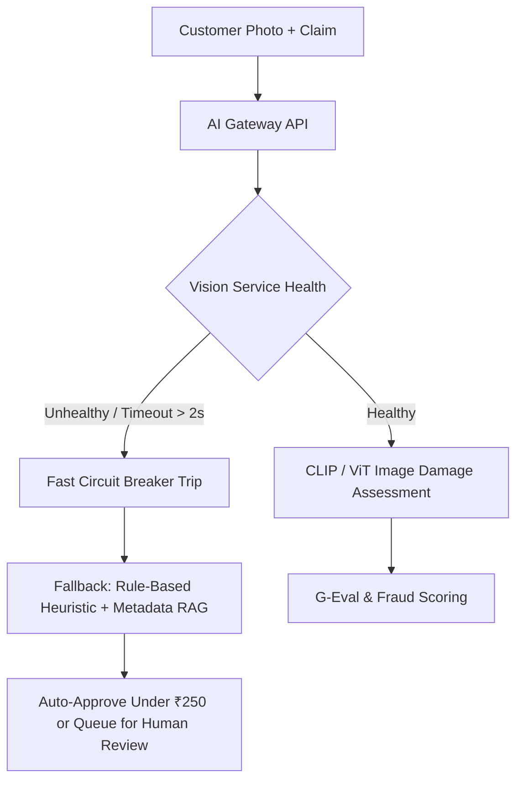

# Runbook: Multimodal Vision Dispute RAG Failover

**Severity Level**: SEV-2 / High  
**Service Impact**: Customer Dispute Processing Latency Spikes, Refund Bottlenecks, Support Desk Backlog  
**Primary On-Call Role**: Principal AI Engineer / GenAI Systems Lead  
**SLO Target**: Failover to fast text-only heuristic mode < 60 seconds; p99 resolution latency < 500ms.

---

## 1. Trigger Conditions & Symptoms

- **`AlertVisionInferenceErrorSpike`**: 5xx HTTP response rate on `/api/v1/dispute/resolve` exceeds 3% over 5 minutes.
- **`AlertVisionLatencyExceeded`**: P99 latency on image multimodal analysis exceeds 4,500ms (normal: 850ms).
- **`AlertGPUOOMKilled`**: Triton Inference Server or vLLM container restarts due to CUDA Out-Of-Memory.



---

## 2. Immediate Diagnostic Steps

### Step 2.1: Check GPU Node Health & Memory Pressure
```bash
kubectl get nodes -l accelerator=nvidia-gpu
kubectl top pods -n ai-dispute-service
kubectl logs -n ai-dispute-service -l app=vision-rag-server --tail=100
```
*Look for:* CUDA OOM errors (`torch.cuda.OutOfMemoryError`), GPU throttling, or API rate limits on multimodal foundation models.

### Step 2.2: Check Circuit Breaker Status
Query Prometheus metric:
```promql
rate(zomato_circuit_breaker_tripped_total[5m])
```
If count > 0, the gateway has begun shedding traffic to heuristic fallback.

---

## 3. Remediation & Failover Operations

### Option A: Force Immediate Circuit Breaker Failover (Heuristic Mode)
If upstream Vision model is non-responsive or rate-limited, switch the gateway into degraded heuristic fallback mode immediately via ConfigMap:
```bash
kubectl patch configmap dispute-rag-config -n ai-dispute-service \
  --type merge -p '{"data":{"DISPUTE_PROCESSING_MODE":"HEURISTIC_TEXT_ONLY"}}'

kubectl rollout restart deployment/ai-dispute-gateway -n ai-dispute-service
```
*Effect:*
- Bypasses heavy visual inference.
- Evaluates dispute based on order metadata, customer lifetime value (LTV), fraud history, and delivery delay metrics.
- Automatically approves claims <= ₹300; routes claims > ₹300 to human operations with high priority tag.

### Option B: Restart and Purge CUDA Cache on Serving Pods
```bash
kubectl exec -it deployment/vision-rag-server -n ai-dispute-service -- \
  python -c "import torch; torch.cuda.empty_cache(); print('VRAM purged')"

kubectl rollout restart deployment/vision-rag-server -n ai-dispute-service
```

### Option C: Traffic Shedding to Backup Region
If GPU cluster in primary region (`ap-south-1`) suffers an AWS AZ outage:
Update CloudFront Origin Request Policy to failover to `ap-southeast-1`:
```bash
aws route53 change-resource-record-sets \
  --hosted-zone-id Z1ZOMATOPLUS \
  --change-batch file://ops/failover_to_singapore.json
```

---

## 4. Recovery & Post-Failover Verification
- [ ] Primary Vision Triton / vLLM cluster pods are in `Running` state and passing `/healthz`.
- [ ] VRAM utilization is steady at < 78%.
- [ ] Switch `DISPUTE_PROCESSING_MODE` back to `MULTIMODAL_FULL`.
- [ ] Verify `zomato_dispute_resolution_latency_ms{quantile="0.99"}` returns to < 1,200ms.
- [ ] Confirm no claims were erroneously rejected during failover window.
