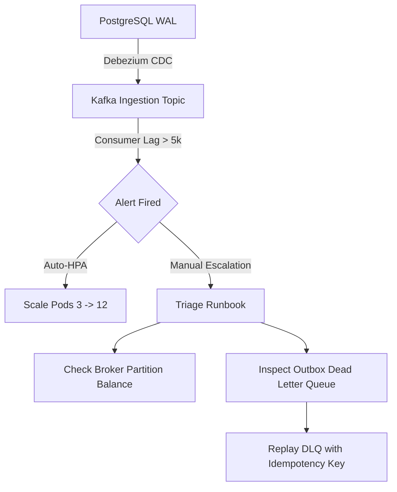

# Runbook: Kafka Consumer Lag & Transactional Outbox Retry Mitigation

**Severity Level**: SEV-2 / High  
**Service Impact**: Delay in Order Status Ingestion, Bronze Lakehouse Ingestion Latency, Rider ETA Recalculations  
**Primary On-Call Role**: Principal Data Platform Engineer / SRE  
**SLO Target**: Kafka consumer lag < 1,000 messages; Outbox retry resolution < 5 minutes.

---

## 1. Trigger Conditions & Automated Alerts

The on-call engineer is paged under any of the following Prometheus alert conditions:
- **`AlertKafkaConsumerLagHigh`**: Consumer group `zomato-lakehouse-cdc-group` has lag > 5,000 messages across any partition for > 3 minutes.
- **`AlertOutboxDLQThresholdExceeded`**: `zomato_outbox_dlq_count > 25` events in 5 minutes.
- **`AlertOutboxPublicationFailed`**: More than 10 consecutive failures attempting to append to MSK topic `zomato.orders.events`.



---

## 2. Immediate Diagnostic Steps (First 5 Minutes)

### Step 2.1: Check Consumer Lag by Partition
Run from the bastion host or Kubernetes admin container:
```bash
kubectl exec -it deployment/kafka-client -- kafka-consumer-groups \
  --bootstrap-server msk-cluster.production.zomato.internal:9092 \
  --group zomato-lakehouse-cdc-group \
  --describe
```
*Look for:* Hot partitions (e.g., Partition 3 with 25,000 lag while Partitions 0-2 have 0 lag). This indicates key skew on `restaurant_id` or `city`.

### Step 2.2: Inspect Transactional Outbox Pending and DLQ Records
Connect to primary PostgreSQL read-replica:
```sql
SELECT status, count(*), min(created_at), max(retry_count)
FROM zomato_order_outbox
WHERE status IN ('PENDING', 'DLQ', 'FAILED')
GROUP BY status;
```
If `status = 'DLQ'` has records:
```sql
SELECT event_id, idempotency_key, aggregate_id, retry_count, last_error
FROM zomato_order_outbox
WHERE status = 'DLQ'
ORDER BY created_at DESC LIMIT 10;
```

---

## 3. Mitigation & Remediation Procedures

### Procedure A: Horizontal Scaling of Consumers
If partition count allows (topic has 24 partitions, current pods = 6):
```bash
kubectl scale deployment/zomato-cdc-consumer --replicas=24 -n data-platform
```
Monitor lag drain rate:
```bash
watch -n 5 "kubectl exec -it deployment/kafka-client -- kafka-consumer-groups \
  --bootstrap-server msk-cluster.production.zomato.internal:9092 \
  --group zomato-lakehouse-cdc-group \
  --describe | awk '{sum += \$6} END {print \"Total Lag: \" sum}'"
```

### Procedure B: Idempotent DLQ Replay
The Zomato Outbox engine uses SHA-256 idempotency keys (`idempotency_key`), making replays completely safe against double charging:
```bash
# Execute safe replay script
python -m ops.replay_outbox_dlq --max-batch=500 --topic=zomato.orders.events
```

SQL fallback for manual replay:
```sql
BEGIN;
-- Move transient failures back to PENDING for outbox worker pickup
UPDATE zomato_order_outbox
SET status = 'PENDING', retry_count = 0, last_error = NULL
WHERE status = 'DLQ' AND created_at > NOW() - INTERVAL '2 hours';
COMMIT;
```

### Procedure C: Broker Hot Partition Rebalancing
If partition skew is caused by an unprecedented volume burst from a single hyperlocal zone (e.g., Koramangala, Bengaluru):
1. Temporarily increase consumer fetch size:
   ```properties
   max.poll.records=1000
   fetch.min.bytes=1048576
   ```
2. Trigger rolling restart of consumer pods:
   ```bash
   kubectl rollout restart deployment/zomato-cdc-consumer -n data-platform
   ```

---

## 4. Verification & Resolution Checklist
- [ ] Total consumer lag on `zomato-lakehouse-cdc-group` is < 500 across all 24 partitions.
- [ ] Outbox DLQ table is drained to 0.
- [ ] Delta Lake Bronze append latency drops below 60 seconds (`p99 < 45s`).
- [ ] Prometheus metrics `zomato_order_events_published_total` counter is steadily incrementing.
- [ ] Notify `#war-room-data-platform` on Slack with resolution summary and trigger postmortem draft.
